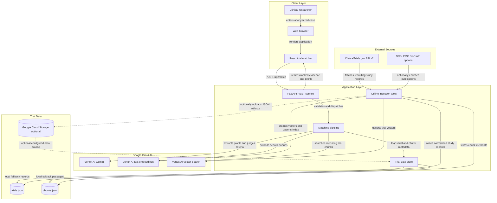

# Architecture Diagram

This project is a clinical-trial matching application with a React browser interface and a FastAPI service. Its offline ingestion flow prepares a registry corpus for retrieval; at request time, the service combines vector search with evidence-constrained eligibility assessment.

## Application Architecture

<!-- mermaid-checked: no \n, no em-dash/en-dash, no {} in labels, subgraphs are id["label"], arrows are -->|"label"|, all subgraphs closed by end, ids unique -->

### Technology Stack Summary

| Layer | Technology | Version | Purpose |
|---|---|---|---|
| Frontend | React and React DOM | `^18.3.1` | Browser interface, patient-case input, profile and trial result display |
| Frontend tooling | Vite and React plugin | `^5.4.0`, `^4.3.1` | Local development server and production asset build |
| Backend API | Python, FastAPI, Uvicorn | Python version not pinned; `0.115.*`, `0.32.*` | HTTP API and ASGI server |
| API models | Pydantic and pydantic-settings | `>=2.8`, `>=2.4` | Request validation, structured model responses, environment-backed settings |
| LLM | Google Gen AI SDK with Vertex AI | `>=1.20.0`; Gemini model configured as `gemini-2.5-flash` | Patient profile extraction and criterion-level assessment |
| Embeddings | Vertex AI text embedding model | `text-embedding-005`, 768 dimensions | Query and trial-text vectors |
| Vector retrieval | Vertex AI Matching Engine | `google-cloud-aiplatform >=1.80.0` | Recruiting-trial nearest-neighbor search |
| Object storage | Google Cloud Storage | `google-cloud-storage >=2.18.0`; optional | Optional remote storage for processed JSON artifacts |
| Local data | JSON files | N/A | Processed trial records and vector-index chunk metadata |
| Trial ingestion | ClinicalTrials.gov API v2 | API version 2 | Fetches recruiting study records |
| Publication enrichment | NCBI PMC BioC API | N/A; optional | Retrieves available open-access abstracts for trial references |

### Data Storage & External Services

There is no relational database in the inspected application. Trial records and chunk metadata are held in `backend/data/processed/trials.json` and `chunks.json`, cached in-process by the trial store, and optionally read from or uploaded to Google Cloud Storage when configured. Vector representations live in Vertex AI Vector Search, with embedding and generative-model requests sent to Vertex AI. The offline ingestion scripts fetch recruiting studies from ClinicalTrials.gov and can optionally enrich records with abstracts from the PMC BioC API.

### Key Architectural Decisions

- Separates offline corpus preparation and vector-index population from online request handling.
- Uses embedding-based retrieval with trial-level Reciprocal Rank Fusion, then performs evidence-based criterion assessment on only a configured subset of candidates.
- Validates model quotes against source text and calculates the final eligibility verdict deterministically; a request-level guard rejects likely identifiers before processing.
- Uses local processed JSON as the default data source and supports GCS as an optional configured source or artifact destination.

## Component Relationships

The request path starts in the browser, enters the FastAPI route, and is orchestrated by the matching pipeline. Patient parsing and trial judging use structured model output; retrieval embeds queries and resolves vector hits against cached trial/chunk metadata. The separate ingestion path fetches and shapes registry records, optionally attaches publication abstracts, creates chunks, and populates the same data and vector-index artifacts consumed by the online path.

```mermaid
flowchart LR
    subgraph Presentation["Presentation"]
        cMain["main.jsx"]
        cApp["App.jsx"]
        cApi["api.js"]
        cProfile["ProfilePanel.jsx"]
        cCard["TrialCard.jsx"]
    end
    subgraph ApiLayer["API"]
        cFastAPI["main.py FastAPI routes"]
        cSchemas["schemas.py Pydantic models"]
    end
    subgraph Business["Matching Business Logic"]
        cPipeline["pipeline.py"]
        cParser["patient_parser.py"]
        cJudge["eligibility_judge.py"]
        cRetriever["retriever.py"]
    end
    subgraph DataInfra["Data and Infrastructure"]
        cEmbed["embeddings.py"]
        cTrialStore["trial_store.py"]
        cGCS["gcs_store.py"]
        cTrialData[("trials.json")]
        cChunkData[("chunks.json")]
    end
    subgraph CorpusBuild["Offline Corpus Build"]
        cFetch["fetch_trials.py"]
        cEnrich["fetch_pmc.py"]
        cChunker["chunker.py"]
        cIndex["build_index.py"]
    end

    cMain -->|"mounts"| cApp
    cApp -->|"submits patient case"| cApi
    cApp -->|"shows extracted profile"| cProfile
    cApp -->|"renders ranked matches"| cCard
    cApi -->|"sends JSON request"| cFastAPI
    cFastAPI -->|"validates request and response"| cSchemas
    cFastAPI -->|"dispatches matching request"| cPipeline
    cPipeline -->|"extracts explicit patient facts"| cParser
    cPipeline -->|"retrieves trial candidates"| cRetriever
    cPipeline -->|"loads candidate trial details"| cTrialStore
    cPipeline -->|"assesses each candidate"| cJudge
    cParser -->|"requests structured profile"| cSchemas
    cParser -->|"returns structured patient profile"| cPipeline
    cRetriever -->|"creates retrieval query vectors"| cEmbed
    cRetriever -->|"resolves hit metadata"| cTrialStore
    cJudge -->|"returns verified criterion evidence"| cPipeline
    cJudge -->|"applies age and sex rules"| cSchemas
    cTrialStore -->|"caches trial records"| cTrialData
    cTrialStore -->|"caches chunk passages"| cChunkData
    cTrialStore -.->|"reads remotely when configured"| cGCS
    cPipeline -->|"returns profile and ranked matches"| cFastAPI
    cFastAPI -->|"returns response JSON"| cApi
    cFetch -->|"provides normalized trial records"| cEnrich
    cEnrich -->|"optional publication data"| cChunker
    cTrialData -->|"processed trial records"| cChunker
    cChunker -->|"trial text chunks"| cIndex
    cIndex -->|"embeds chunk documents"| cEmbed
    cFetch -->|"writes normalized trial records"| cTrialData
    cEnrich -->|"updates optional publication fields"| cTrialData
    cIndex -->|"writes chunk lookup metadata"| cChunkData
    cIndex -.->|"optionally uploads artifacts"| cGCS
```

<!-- mermaid-checked: no \n, no em-dash/en-dash, no {} in labels, subgraphs are id["label"], arrows are -->|"label"|, all subgraphs closed by end, ids unique -->

### Component Inventory

| Component | Layer | Type | Responsibility |
|---|---|---|---|
| `main.jsx` | Presentation | React entry point | Mounts the React application and global styles |
| `App.jsx` | Presentation | Page component | Captures case input, submits matching requests, handles loading/errors, and displays results |
| `api.js` | Presentation | HTTP client module | Sends the patient case to `/api/match` and parses the response |
| `ProfilePanel.jsx` | Presentation | React component | Displays structured patient facts returned by the API |
| `TrialCard.jsx` | Presentation | React component | Displays each trial match, verdict, criteria evidence, and retrieved passages |
| `main.py` | API | FastAPI application and routes | Configures CORS and exposes health and matching endpoints |
| `schemas.py` | API and contracts | Pydantic models | Validates the request and defines profile, criterion, trial-match, and response shapes |
| `pipeline.py` | Business logic | Request orchestrator | Applies the identifier guard, parses the case, retrieves candidates, judges trials, ranks results, and builds the response |
| `patient_parser.py` | Business logic | LLM adapter | Extracts explicitly stated patient facts and a condition-focused retrieval query |
| `retriever.py` | Business logic | Vector retrieval service | Embeds queries, filters vector search to recruiting trials, and fuses hits into trial-level candidates |
| `eligibility_judge.py` | Business logic | Evidence assessor | Assesses trial criteria, verifies quoted evidence against source text, applies structured age/sex checks, and computes verdicts |
| `embeddings.py` | Infrastructure | Embedding client | Batches, retries, and normalizes query or document embeddings |
| `trial_store.py` | Data access | Cached JSON data store | Loads trial records and chunk metadata from GCS when configured, otherwise from local processed JSON |
| `gcs_store.py` | Infrastructure | Object storage adapter | Uploads and downloads JSON artifacts in the configured GCS bucket |
| `fetch_trials.py` | Offline ingestion | Registry fetcher | Fetches recruiting trials from ClinicalTrials.gov and normalizes study fields |
| `fetch_pmc.py` | Offline ingestion | Publication enricher | Optionally resolves trial references and attaches available PMC abstracts |
| `chunker.py` | Offline ingestion | Text transformer | Splits trial overview and eligibility text into indexed chunks |
| `build_index.py` | Offline ingestion | Vector index builder | Embeds chunks, upserts index datapoints, writes chunk metadata, and optionally uploads JSON files |
| `trials.json` | Data | Processed trial corpus | Stores normalized study records and eligibility details used by the matcher |
| `chunks.json` | Data | Chunk metadata | Maps vector datapoint identifiers to trial identifiers, chunk types, and source text |
