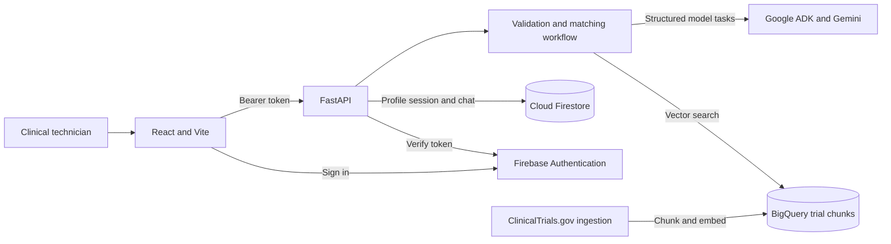
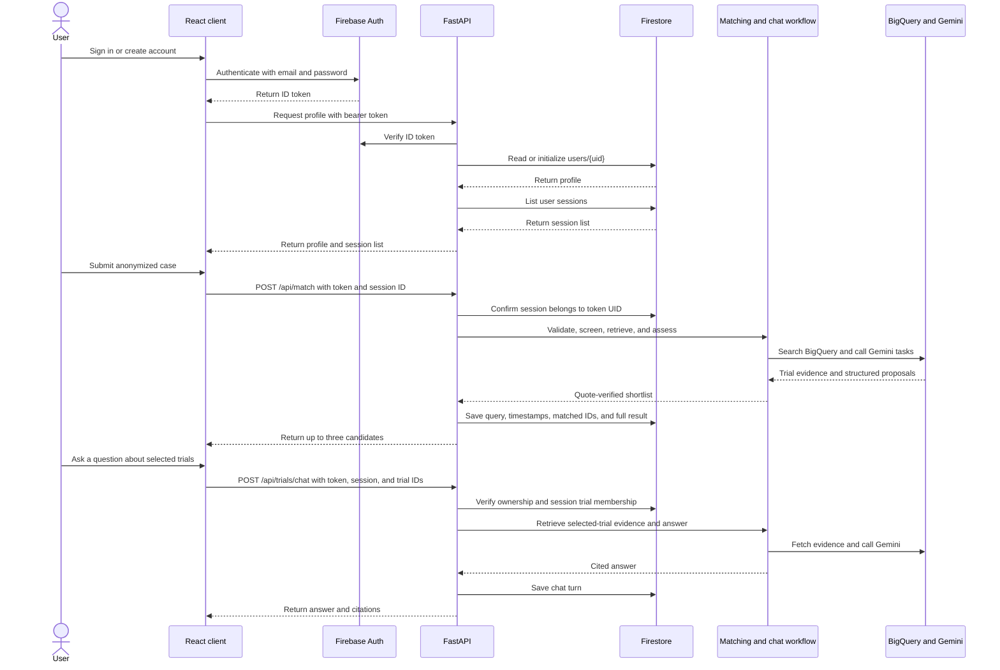
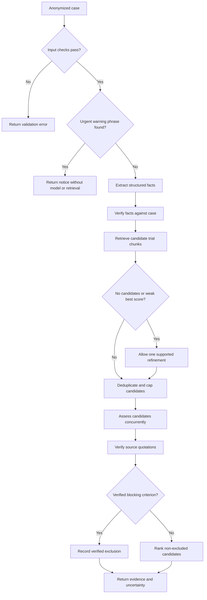
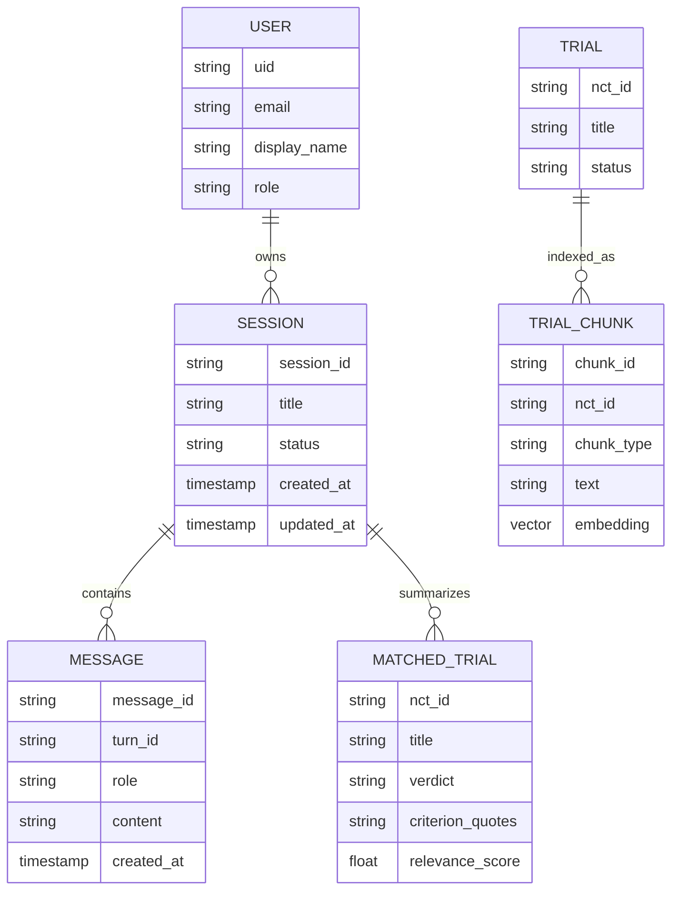
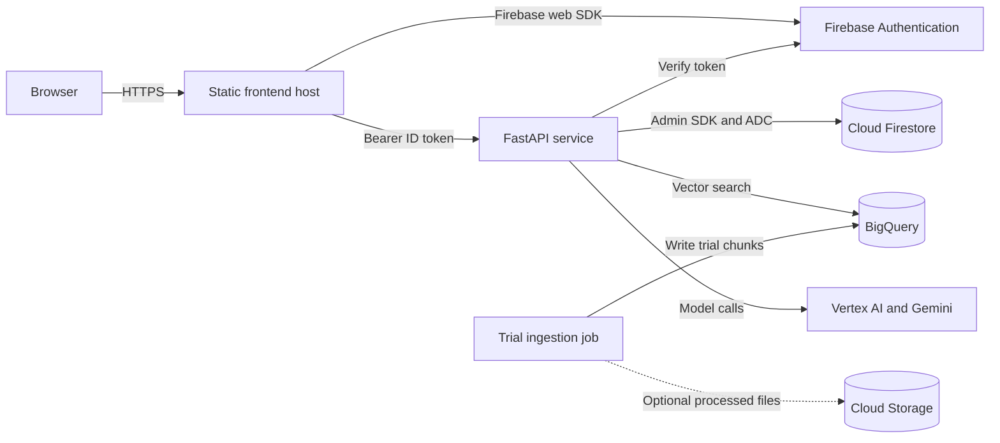
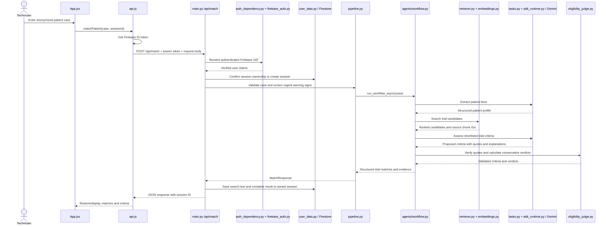

# Clinical Trial RAG Architecture

## Table of Contents

- [Overview](#overview)
- [High-Level Architecture](#high-level-architecture)
- [Production File-Level Flow](#production-file-level-flow)
- [Components](#components)
- [Main User Flow](#main-user-flow)
- [Business Logic](#business-logic)
- [Data Model](#data-model)
- [Deployment](#deployment)
- [Security](#security)
- [Scalability](#scalability)

## Overview

The system has a React/Vite client, Firebase Authentication, a Python/FastAPI service, and Google Cloud data/model services. FastAPI verifies Firebase ID tokens before profile, session, matching, or chat operations. The matching workflow retrieves indexed trial chunks from BigQuery, uses Google ADK and Gemini for structured extraction and assessment, verifies evidence in application code, and saves the validated query and full structured result to the owning user's Firestore session.

## High-Level Architecture



The browser obtains an ID token from Firebase and sends it to FastAPI. The API verifies the token, enforces UID/session ownership, calls the matching or chat workflow, and persists user data through Firebase Admin. Trial ingestion is an offline path independent of user requests.

The evidence dashboard summarizes validated search facts and criterion coverage across the returned shortlist. Criterion detail remains tied to verified trial quotes and supported patient evidence. Its print-ready HTML report is assembled in the browser on demand, includes official ClinicalTrials.gov links, and is not sent back to the API.

## Components

| Component | Responsibility |
|---|---|
| React/Vite workspace | Sign-in, case intake, trial shortlist, evidence traceability dashboard, trial detail, and follow-up chat UI. |
| Firebase Authentication | Email/password accounts and signed ID tokens. |
| FastAPI `main.py` | HTTP routes, CORS, request IDs, authentication dependencies, and error mapping. |
| `auth_dependency.py` / `firebase_auth.py` | Verify ID tokens and initialize Firebase Admin/Firestore access. |
| `user_data.py` | Store profiles, queries, full match results, and chat turns under a user's UID. |
| `pipeline.py` / `workflow.py` | Validate cases, apply urgent screening, retrieve candidates, assess criteria, and rank results. |
| `adk_runtime.py` / `tasks.py` / `tools.py` | Run constrained extraction, assessment, and chat model tasks with bounded retrieval. |
| `eligibility_judge.py` | Verify criterion quotes and calculate conservative verdicts in ordinary application code. |
| `chat.py` / `retriever.py` / `trial_store.py` | Retrieve evidence for allowed trial IDs and create cited responses. |
| Ingestion scripts | Fetch, normalize, chunk, embed, and load trial data. |
| BigQuery and Vertex AI | Store/search trial vectors and create embeddings. |

## Main User Flow



The API checks token identity and session ownership before processing case matching or chat. Chat trial IDs must be part of that session's saved result. Model proposals are validated before they are returned or persisted.

## Business Logic



A request makes one initial retrieval and at most one validated refinement retrieval. Candidate count and assessment concurrency are capped. A verified blocking criterion excludes a trial; otherwise, supported evidence can yield `POSSIBLY_ELIGIBLE`, while no supported criterion evidence yields `COULD_NOT_ASSESS`. The application never treats retrieval similarity as eligibility probability.

## Data Model



Firestore paths are `users/{uid}`, `users/{uid}/sessions/{sessionId}`, and `users/{uid}/sessions/{sessionId}/messages/{messageId}`. Each session stores its title, validated search query, `createdAt`, `searchedAt`, `updatedAt`, matched-trial IDs, complete structured matching result, and status. The result retains criteria assessments and evidence so a reopened session can be restored. Chat turns use deterministic message document IDs, so a retried chat request updates the same records instead of duplicating them. Sidebar listing returns a lightweight result preview; opening a session returns the full result and chat history. BigQuery stores trial chunks and embeddings. The diagram shows conceptual relationships, not a claim that each entity is a separate collection/table.

## Deployment



This is the deployment shape supported by the code; no production hosting manifests are included. Use HTTPS, configure the production frontend origin in CORS, and grant the API service identity only the necessary Firebase/Firestore, BigQuery, and Vertex AI permissions. Deploy `firestore.rules`, which denies direct browser database reads and writes.

## Security

- Firebase ID tokens are required for profile, session, matching, and chat routes. Health and readiness routes remain public.
- The backend derives the UID from a verified token, scopes Firestore paths to that UID, and checks session ownership.
- Chat requests can use only trial IDs in the owned session's saved match result.
- The application role is fixed to `clinical_technician` by the backend.
- Firestore client rules deny direct browser access. Admin SDK writes rely on server credentials and API ownership checks.
- Token verification skips a per-request revocation lookup to reduce latency; a revoked token may remain accepted until normal expiration.
- Submitted, identifier-screened patient case narratives, match assessments, and chat turns are persisted under the owning user's session. Delete a session to remove its saved data. The identifier check is limited and does not provide comprehensive de-identification.
- Retrieved trial text and patient input are treated as untrusted. Retrieval is bounded; structured outputs and quotations are validated before final verdicts.
- Identifier screening and urgent phrase checks are limited safeguards, not comprehensive de-identification or emergency triage.
- No regulatory compliance certification is claimed. Results require qualified clinical review.

## Scalability

- Candidate assessment and final-result caps come from configuration; concurrent assessment is bounded by `ADK_CONCURRENCY`.
- Each model call and retrieval call has a timeout. The matching and chat workflows also have derived overall timeouts capped in code.
- BigQuery provides managed vector storage and search. Monitor query cost and latency when tuning `CANDIDATES_TO_RETRIEVE`.
- Ingestion is independent of request handling and can be scheduled externally; the repository does not include a scheduler or autoscaling configuration.
- User data is partitioned by Firebase UID. Session and message retrieval limits bound data returned to the client.
- Production still needs platform-specific autoscaling, rate limits, monitoring, deployment automation, and data-retention policies.

The mocked workflow latency regression test compares the same six delayed assessment calls at concurrency 1 and 6. A local run measured medians of 226.3 ms and 39.9 ms respectively. These values validate the concurrency change in a simulated workflow; they do not predict live model or BigQuery latency.

## Production File-Level Flow

This diagram follows the actual source modules that handle sign-in, a saved search, trial assessment, and the response shown in the browser. Arrows mean that the first file calls, imports, or sends data to the next file/service.

```mermaid
flowchart TB
    subgraph Browser[Browser — React frontend]
        AuthUI[frontend/src/auth/AuthScreen.jsx<br/>Sign-in and account creation]
        AuthState[frontend/src/auth/AuthContext.jsx<br/>Firebase user and profile state]
        FirebaseClient[frontend/src/firebase.js<br/>Firebase client setup]
        App[frontend/src/App.jsx<br/>Workspace and search actions]
        SessionHook[frontend/src/hooks/useSessionManager.js<br/>Load and switch sessions]
        API[frontend/src/api.js<br/>Bearer token and HTTP requests]
        ResultUI[frontend/src/components/results/*<br/>Trial results and assessment view]
        ChatUI[frontend/src/components/chat/ChatDrawer.jsx<br/>Follow-up questions]
    end

    subgraph APIService[Backend — FastAPI]
        Main[backend/app/main.py<br/>Routes, request IDs, errors]
        Schemas[backend/app/schemas.py<br/>Validate API data]
        AuthDep[backend/app/services/auth_dependency.py<br/>Require verified user]
        AuthSvc[backend/app/services/firebase_auth.py<br/>Firebase Admin token check]
        Pipeline[backend/app/services/pipeline.py<br/>Validate case and urgent screen]
        Workflow[backend/app/agents/workflow.py<br/>Coordinate retrieval and assessment]
        Tasks[backend/app/agents/tasks.py<br/>Focused Gemini task prompts]
        Runtime[backend/app/agents/adk_runtime.py<br/>Run structured model calls]
        Tools[backend/app/agents/tools.py<br/>Bounded retrieval access]
        Retriever[backend/app/services/retriever.py<br/>BigQuery vector search]
        Embed[backend/app/services/embeddings.py<br/>Create query vectors]
        Judge[backend/app/services/eligibility_judge.py<br/>Verify quotes and verdict]
        TrialStore[backend/app/services/trial_store.py<br/>Load trial and chunk metadata]
        UserData[backend/app/services/user_data.py<br/>UID-scoped Firestore operations]
        Chat[backend/app/services/chat.py<br/>Retrieve chat evidence and answer]
    end

    subgraph Cloud[Managed services]
        Firebase[Firebase Authentication]
        Firestore[(Cloud Firestore<br/>users/{uid}/sessions/{sessionId})]
        BigQuery[(BigQuery<br/>trial chunks and vectors)]
        Gemini[Gemini via Google ADK]
        Vertex[Vertex AI embeddings]
        GCS[(Cloud Storage<br/>optional processed JSON)]
    end

    AuthUI --> AuthState
    AuthState --> FirebaseClient
    FirebaseClient <--> Firebase
    AuthState -->|profile request with ID token| API
    App --> SessionHook
    App --> API
    SessionHook --> API
    API -->|Bearer ID token| Main
    Main --> Schemas
    Main --> AuthDep --> AuthSvc --> Firebase
    Main -->|profile, session, query, result, chat| UserData --> Firestore
    Main --> Pipeline --> Workflow
    Workflow --> Tasks --> Runtime --> Gemini
    Workflow --> Tools --> Retriever
    Retriever --> Embed --> Vertex
    Retriever --> BigQuery
    Workflow --> Judge
    Workflow --> TrialStore --> GCS
    TrialStore -->|local fallback| Local[(backend/data/processed JSON)]
    Main --> Chat
    Chat --> BigQuery
    Chat --> Embed
    Chat --> Tasks
    Main -->|validated JSON response| API
    API --> ResultUI
    API --> ChatUI
```

### Search request, in execution order



### File responsibilities and where to make changes

| File | What it owns | Start here when… |
| --- | --- | --- |
| `frontend/src/main.jsx` | Mounts React providers and the root app. | Changing app bootstrapping or top-level providers. |
| `frontend/src/firebase.js` | Initializes the Firebase browser SDK. | Changing browser Firebase configuration. |
| `frontend/src/auth/AuthScreen.jsx` | Renders sign-in and registration forms. | Changing authentication screens or form validation. |
| `frontend/src/auth/AuthContext.jsx` | Tracks Firebase sign-in state and loads the backend profile. | Changing the frontend authenticated-user lifecycle. |
| `frontend/src/App.jsx` | Connects search form, sessions, result selection, and main workspace navigation. | Changing how the main screens interact. |
| `frontend/src/api.js` | Adds Firebase ID tokens and calls backend endpoints. | Adding or changing frontend API requests. |
| `frontend/src/hooks/useSessionManager.js` | Loads, creates, switches, renames, and deletes sessions. | Changing client-side session behavior. |
| `frontend/src/components/results/ClinicalAssessmentPage.jsx` | Displays criterion outcomes, evidence passages, and locations. | Changing the dedicated assessment summary page. |
| `frontend/src/components/results/CriteriaSection.jsx` | Filters and renders individual assessed criteria. | Changing criterion cards or Met/Blocking/Unknown filters. |
| `frontend/src/components/results/PassagesSection.jsx` | Renders retrieved trial source passages. | Changing evidence passage display. |
| `frontend/src/components/chat/ChatDrawer.jsx` | Renders the trial question and answer interface. | Changing chat interaction UI. |
| `backend/app/main.py` | Creates FastAPI and implements health, auth, match, chat, and session routes. | Adding/changing HTTP routes or request-level error handling. |
| `backend/app/schemas.py` | Defines Pydantic request/response objects. | Changing the JSON contract between frontend and backend. |
| `backend/app/services/auth_dependency.py` | Rejects missing/invalid bearer tokens and extracts UID claims. | Changing which routes require an authenticated Firebase user. |
| `backend/app/services/firebase_auth.py` | Initializes Firebase Admin and verifies ID tokens. | Changing backend Firebase initialization or token verification. |
| `backend/app/services/pipeline.py` | Validates case text, runs urgent screening, and starts the workflow. | Changing pre-workflow validation or urgent screening behavior. |
| `backend/app/agents/workflow.py` | Coordinates extraction, retrieval, assessment, ranking, and response assembly. | Changing the end-to-end matching algorithm. |
| `backend/app/agents/tasks.py` | Defines structured model tasks for extraction, refinement, assessment, and chat. | Changing what the Gemini model is asked to do. |
| `backend/app/agents/adk_runtime.py` | Creates/runs the bounded Google ADK agent calls. | Changing model runtime, timeout, or structured output handling. |
| `backend/app/agents/tools.py` | Restricts workflow retrieval calls and validates search queries. | Changing allowed retrieval access during model workflow. |
| `backend/app/services/retriever.py` | Embeds queries, calls BigQuery vector search, and ranks trial candidates. | Changing trial candidate retrieval or ranking inputs. |
| `backend/app/services/embeddings.py` | Calls Vertex AI to create query/document embeddings. | Changing embedding model or vector request behavior. |
| `backend/app/services/eligibility_judge.py` | Checks model quotes and computes final criterion impact/verdict. | Changing deterministic verification and eligibility safeguards. |
| `backend/app/services/trial_store.py` | Loads processed trial metadata/chunks from configured sources. | Changing trial metadata or local/GCS fallback loading. |
| `backend/app/services/user_data.py` | Reads/writes Firestore profiles, sessions, matching results, and chat turns. | Changing persistence or session document fields. |
| `backend/app/services/chat.py` | Retrieves evidence from allowed trials and produces cited answers. | Changing follow-up answer evidence retrieval or chat grounding. |
| `backend/app/config.py` | Loads typed environment settings. | Adding/changing environment variables and defaults. |
| `backend/ingestion/ingest.py` | Coordinates trial ingestion and data preparation. | Changing the offline ingestion pipeline. |
| `backend/ingestion/fetch_trials.py` | Downloads and normalizes ClinicalTrials.gov records. | Changing the source trial feed or source fields. |
| `backend/ingestion/chunker.py` | Splits trial records into retrieval passages. | Changing how trial text becomes searchable chunks. |
| `backend/ingestion/build_index.py` | Embeds chunks and loads the BigQuery search table. | Changing index construction and BigQuery loading. |

**Fastest trace for a search:** start at `App.jsx` → `api.js:matchPatient` → `main.py:match` → `pipeline.py:run_async` → `workflow.py:run_workflow_async` → `tools.py:ApprovedTrialRetrieval.search` → `retriever.py:retrieve` → `tasks.py` / `adk_runtime.py` → `eligibility_judge.py` → back to `main.py` and `user_data.py` for session persistence → `api.js` → result components.

**Fastest trace for sign-in and history:** `AuthScreen.jsx` → `AuthContext.jsx` → Firebase Authentication → `api.js` profile/session calls → `main.py` auth/session routes → `auth_dependency.py` → `firebase_auth.py` → `user_data.py` → Firestore. The server UID comes from the verified token; the client does not select the owner UID.
