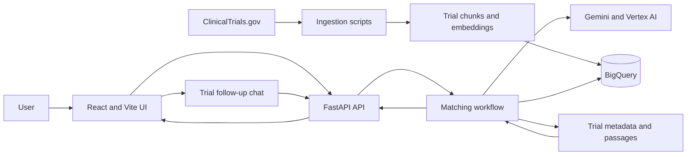
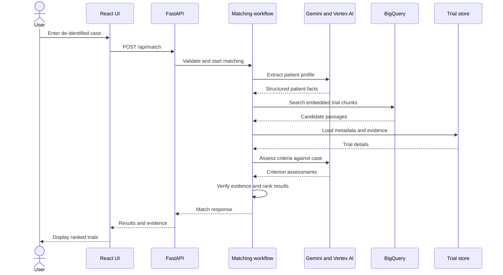
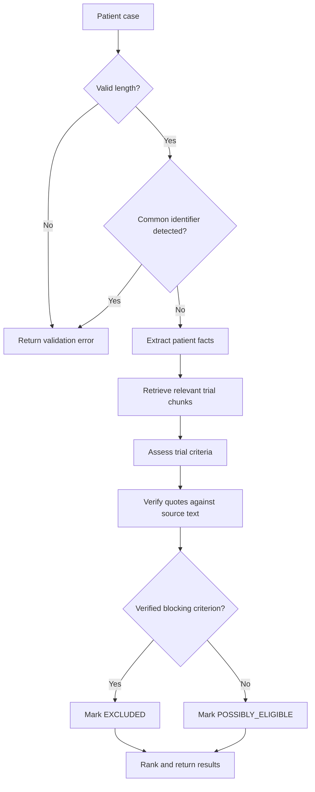
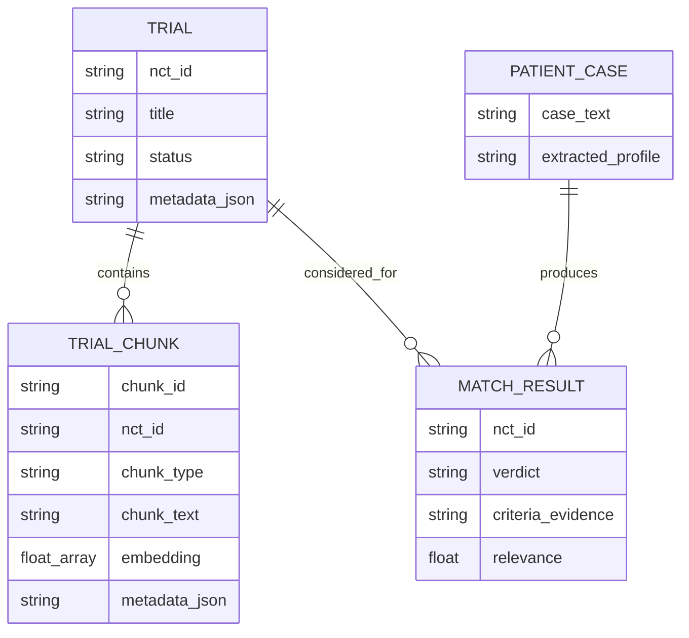
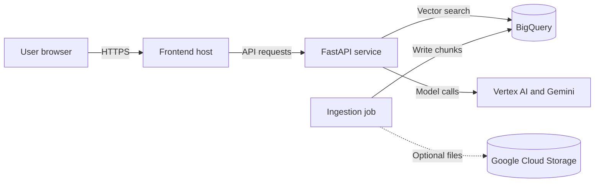

# Clinical Trial RAG Architecture

## Table of Contents

- [Overview](#overview)
- [High-Level Architecture](#high-level-architecture)
- [Components](#components)
- [Main User Flow](#main-user-flow)
- [Business Logic](#business-logic)
- [Data Model](#data-model)
- [Deployment](#deployment)
- [Security](#security)
- [Scalability](#scalability)

## Overview

Clinical Trial RAG has an offline data-preparation path and an online matching path. The ingestion scripts fetch trial records, create text chunks, and store their embeddings in BigQuery. At runtime, the React application sends a patient case to FastAPI, which retrieves candidate passages, asks Gemini to extract patient facts and assess criteria, and returns ranked results with evidence for review.

## High-Level Architecture

Ingestion prepares the searchable trial dataset separately from user requests. The online API combines parsing, retrieval, assessment, and presentation; follow-up chat is a separate API flow.

## Components

| Component | Responsibility |
|---|---|
| React/Vite frontend | Collects case text and displays patient profiles, trial results, criteria, and chat. |
| FastAPI `main.py` | Provides health, readiness, matching, and chat endpoints. |
| `pipeline.py` | Validates case length and screens for common direct identifiers. |
| `workflow.py` | Coordinates parsing, retrieval, judging, and ranking with Python `asyncio`. |
| `patient_parser.py` | Extracts a structured patient profile using Gemini. |
| `embeddings.py` and `retriever.py` | Embed query text and search BigQuery trial chunks. |
| `eligibility_judge.py` | Assesses trial criteria and verifies evidence quotes against source text. |
| `trial_store.py` | Loads trial metadata and evidence passages from processed data. |
| `chat.py` | Answers follow-up questions about selected trials. |
| `ingestion/` | Fetches trial records, chunks their text, and writes embeddings. |
| BigQuery | Stores trial chunks, metadata, and embedding vectors. |
| Optional GCS | Stores processed files when configured. |

## Main User Flow

The workflow retrieves candidates before evaluating their criteria. Results include evidence intended to help users review the assessment.

## Business Logic

A verified blocking criterion marks a trial `EXCLUDED` for review. Other assessed trials remain `POSSIBLY_ELIGIBLE`; the system does not establish clinical eligibility.

## Data Model

Trial and chunk fields represent the BigQuery and processed-data concepts. Patient case and match result represent request and response data; they are not documented as persisted BigQuery entities.

## Deployment

The repository does not specify a production hosting platform. Configure frontend hosting, API hosting, network access, secrets, and `CORS_ORIGINS` for the chosen environment.

## Security

- The pipeline screens for common email, phone, and US SSN patterns. This is a basic guardrail, not comprehensive de-identification.
- Request logging records request metadata and avoids logging patient request bodies.
- Restrict `CORS_ORIGINS` to the intended frontend origins.
- Use least-privilege Google Cloud service accounts and a secure secret store in deployment.
- Authentication and authorization are not implemented in this repository; add them before multi-user deployment.
- Treat model output as advisory and require qualified clinical review.

## Scalability

- BigQuery provides managed storage and vector search. Tune candidate counts and monitor query cost and latency.
- Workflow concurrency and timeouts are configurable; tune them against model quotas and API capacity.
- Run ingestion independently from the API and schedule refreshes to keep trial data current.
- For larger deployments, add rate limits, caching where appropriate, monitoring, and authenticated access.
- The repository does not include autoscaling or production deployment configuration.
