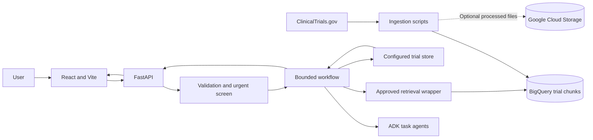
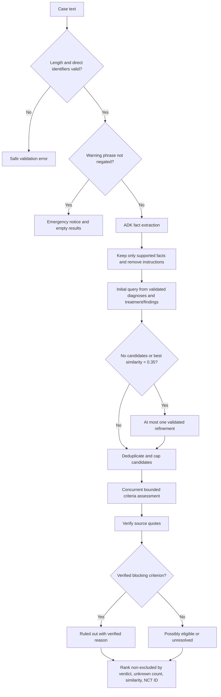
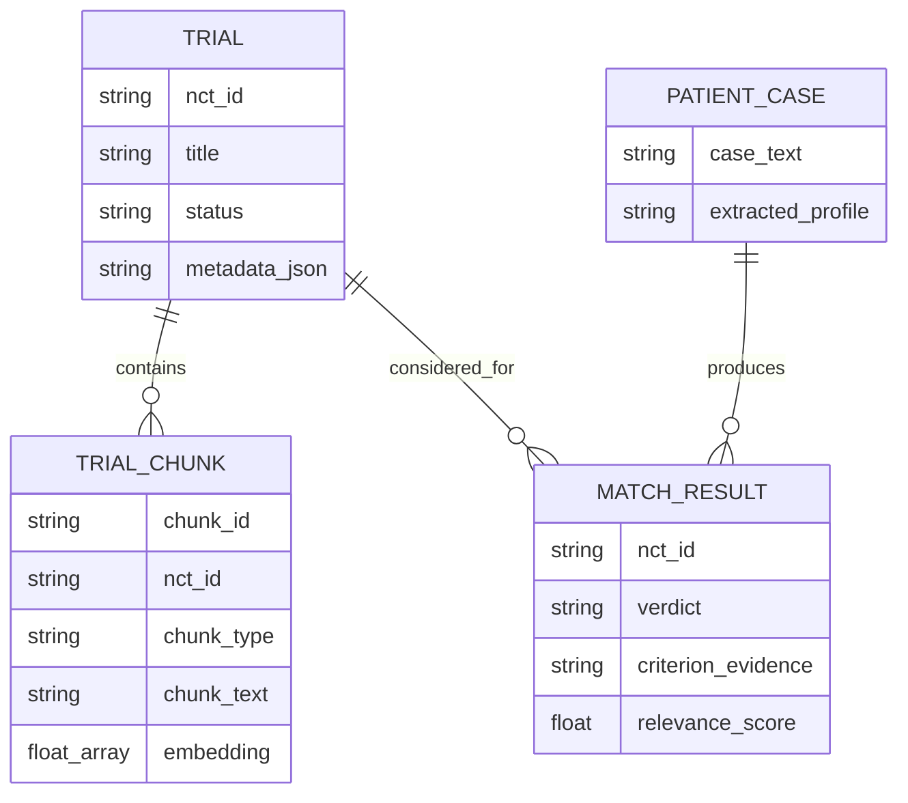
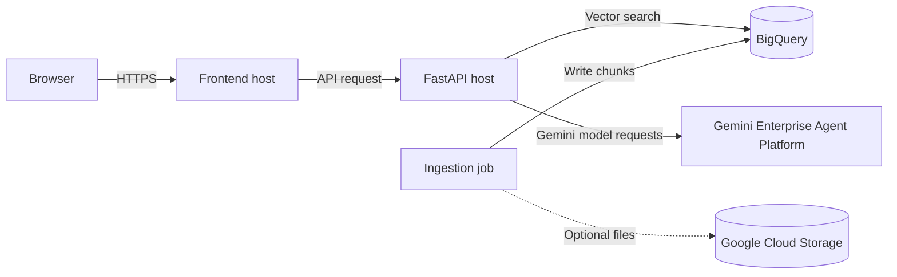

# Clinical Trial RAG Architecture

## Table of Contents

- [Overview](#overview)
- [High-Level Architecture](#high-level-architecture)
- [Components](#components)
- [Main User Flow](#main-user-flow)
- [Business Logic](#business-logic)
- [Data Model](#data-model)
- [Deployment](#deployment)
- [Security](#security)
- [Scalability](#scalability)

## Overview

The application separates offline trial-data preparation from online matching. A bounded ADK layer handles model reasoning. FastAPI and ordinary application code validate inputs, control retrieval, validate evidence, calculate verdicts, and rank results. The API returns preliminary decision support, not a clinical decision.

## High-Level Architecture



Ingestion writes searchable chunks before runtime. The API applies safety checks before model or retrieval work. Agents receive only task data and have no arbitrary cloud, SQL, shell, filesystem, or network tools.

## Components

| Component | Responsibility |
|---|---|
| React/Vite frontend | Sends matching and chat requests; displays notices, uncertainties, criteria, and citations. |
| FastAPI `main.py` | HTTP boundary, request IDs, safe HTTP error mapping, health and readiness. |
| `pipeline.py` | Length and direct-identifier validation, deterministic urgent screening, workflow entry. |
| `agents/adk_runtime.py` | Creates one ADK `LlmAgent` and ephemeral in-memory session per model task; enforces per-call timeout and deletes the session. |
| `agents/tasks.py` | Focused extraction, criteria-assessment, and follow-up chat agents. |
| `agents/tools.py` | Validated retrieval request and request-local two-call budget around the existing retrieval service. |
| `agents/workflow.py` | Extraction, one evidence-driven optional refinement, candidate validation, bounded concurrent assessment, verdict-based shortlist and ruled-out results. |
| `services/eligibility_judge.py` | Verifies model quotes and computes conservative verdicts in ordinary code. |
| `services/chat.py` | Retrieves evidence for validated selected trial IDs and returns citations. |
| `services/trial_store.py` | Loads configured processed trial and passage data. |
| `ingestion/` and BigQuery | Fetch, chunk, embed, and store trial records for vector retrieval. |

## Main User Flow

```mermaid
sequenceDiagram
    actor User
    participant UI as React UI
    participant API as FastAPI
    participant Safety as Validation and urgent screen
    participant WF as Matching workflow
    participant ADK as ADK agents
    participant Tool as Bounded retrieval wrapper
    participant BQ as BigQuery
    User->>UI: Submit anonymized case
    UI->>API: POST /api/match
    API->>Safety: Validate length and identifiers
    Safety->>Safety: Check urgent warning phrases
    alt urgent warning found
        Safety-->>API: Notice and empty results
        API-->>UI: Advisory response
    else continue matching
        Safety->>WF: Start workflow
        WF->>ADK: Extract facts and uncertainty
        ADK-->>WF: Pydantic-validated profile
        WF->>WF: Build query from validated diagnoses and relevant facts
        WF->>Tool: Initial case-grounded retrieval
        Tool->>BQ: Search configured trial chunks
        BQ-->>Tool: Candidate passages
        Tool-->>WF: Candidate list
        opt No candidates or best similarity below 0.35
            WF->>ADK: Propose one profile-grounded query
            ADK-->>WF: At most one refinement proposal
            WF->>Tool: Optional second retrieval (only if query adds a supported term)
            Tool->>BQ: Search configured trial chunks
        end
        par Up to configured assessment concurrency
            WF->>ADK: Assess capped candidate set
            ADK-->>WF: Criterion evidence
        end
        WF->>WF: Verify quotes and compute verdicts
        WF->>WF: Rank non-excluded trials; collect verified exclusions separately
        WF-->>API: MatchResponse
        API-->>UI: Results and disclaimer
    end
```

Each match request makes one initial retrieval and can make at most one refinement retrieval. Refinement is considered only when the initial search returns no valid candidates or its best cosine similarity is below `0.35`. The proposed query must contain only tokens from the validated profile and add at least one token to the initial query. The backend enforces a two-call retrieval budget.

Candidates are deduplicated by canonical NCT ID and limited to `min(CANDIDATES_TO_JUDGE, 10)` (six by default). Independent assessments run concurrently up to `ADK_CONCURRENCY` (six by default). On failure or overall timeout, outstanding tasks are cancelled and awaited for cleanup. The primary shortlist contains up to three non-excluded trials. Verified blockers go to `ruled_out_trials` with the criterion-based reason. Similarity is only a tie-breaker after verdict and unresolved-criterion count. The current conservative calculator does not claim likely eligibility: verified blockers produce `EXCLUDED`; some supported evidence without blockers produces `POSSIBLY_ELIGIBLE`; when no criterion has supported evidence, the result is `COULD_NOT_ASSESS`. An assessed subset cannot prove every requirement is met.

## Business Logic



Missing evidence maps to the `UNKNOWN` criterion state, shown in the UI as “Could not assess.” It never establishes eligibility. Conflicting age and stage mentions are reported and removed from the judge's evidence input; they cannot support a criterion. Trial level `COULD_NOT_ASSESS` is used when no criterion has supported evidence and no blocker was verified. An empty result set describes only the search performed and does not mean no suitable trial exists.

The emergency list is a conservative starter placeholder pending clinician approval. Negation handling is intentionally simple; keyword rules can miss emergencies and can produce false positives.

## Data Model



`TRIAL` and `TRIAL_CHUNK` reflect the trial data concepts stored in processed files and BigQuery. `PATIENT_CASE` and `MATCH_RESULT` describe transient request/response data; they are not stored server-side by this workflow.

## Deployment



The repository has no production hosting manifests. The API currently has no application-level authentication, so keep it local or behind infrastructure-level access controls. Do not expose it publicly or use real patient data until authentication is implemented and reviewed.

## Security

- Length and common direct-identifier checks happen before any model or retrieval call.
- Urgent screening is deterministic and reads the placeholder warning list in `backend/app/urgent_signs.json`. A trigger prevents all matching model and retrieval calls.
- Every agent instruction treats the case, trial records, retrieved passages, and chat question as untrusted data. Inputs are JSON-serialized in a separate user message, not interpolated into instructions.
- ADK agents have no arbitrary tools. Backend-only retrieval validates the query against the case and supported profile facts, filters returned IDs against the configured trial store, and enforces two calls maximum.
- Structured agent outputs are Pydantic-validated. Trial and patient quotes are checked against source text. Verdicts, ranking, and result caps are controlled by application code.
- Each model call uses a fresh in-memory session; it is deleted after that call. No server-side chat history or session persistence is configured.
- Logs avoid patient narratives, extracted facts, queries, prompts, responses, and medical tool payloads. A shared sanitizer logs only request correlation, step, and error category. Framework debug logging is suppressed.
- No authentication or regulatory compliance is implemented or claimed. The emergency list needs qualified clinician review.

## Scalability

- Candidate assessment and final-result caps come from configuration; concurrent assessment is bounded by `ADK_CONCURRENCY`.
- Each model call and retrieval call has a timeout. The matching and chat workflows also have derived overall timeouts capped in code.
- BigQuery provides managed vector storage and search. Monitor query cost and latency when tuning `CANDIDATES_TO_RETRIEVE`.
- Ingestion is independent of request handling and can be scheduled externally, but the repository does not include a scheduler or autoscaling configuration.
- Additional operational needs such as user authentication, access controls, rate limits, monitoring, and deployment automation remain future work.

The mocked workflow latency regression test compares the same six delayed assessment calls at concurrency 1 and 6. A local run measured medians of 226.3 ms and 39.9 ms respectively. These values validate the concurrency change in a simulated workflow; they do not predict live model or BigQuery latency.
