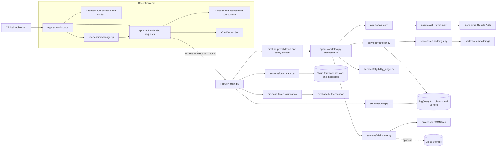
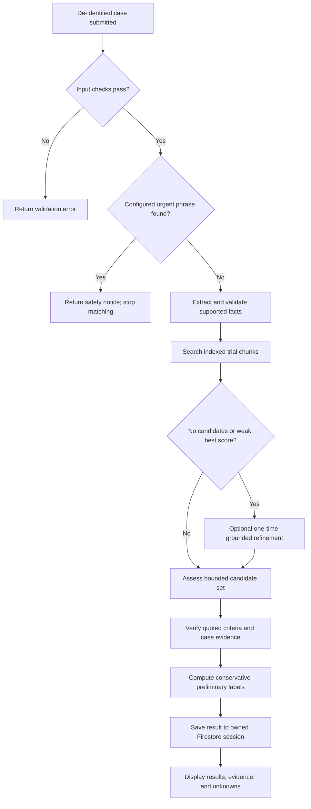
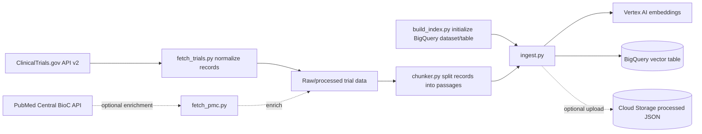

# Clinical Trial RAG

Clinical Trial RAG is a healthcare research-support application that helps a clinical technician or researcher compare a **de-identified patient case** with indexed clinical-trial records. It searches for relevant trials, shows the criteria and patient evidence it used, identifies missing information, and lets the user ask evidence-grounded follow-up questions.

> **Clinical safety:** The application is not a diagnostic tool and does not determine or confirm eligibility. Its results are preliminary research support. A qualified clinical team must review the official trial record and make any decision.

## Contents

- [Project summary for a presentation](#project-summary-for-a-presentation)
- [Problem and solution](#problem-and-solution)
- [What the user can do](#what-the-user-can-do)
- [How one search works](#how-one-search-works)
- [Architecture diagram](#architecture-diagram)
- [Autonomous agents and refinement](#autonomous-agents-and-refinement)
- [How trial data gets into the system](#how-trial-data-gets-into-the-system)
- [Results, evidence, and scores](#results-evidence-and-scores)
- [Sessions and persistence](#sessions-and-persistence)
- [Security and responsible use](#security-and-responsible-use)
- [Technology stack](#technology-stack)
- [File guide](#file-guide)
- [Run locally](#run-locally)
- [Configuration](#configuration)
- [Tests and build](#tests-and-build)
- [Deploy to Cloud Run](#deploy-to-cloud-run)
- [Presentation walkthrough](#presentation-walkthrough)
- [Known limits and next improvements](#known-limits-and-next-improvements)

## Project summary for a presentation

| Topic | Explanation |
|---|---|
| Project | Clinical Trial RAG, a research-support application for reviewing trials against a patient case. |
| User | A clinical technician, researcher, or qualified clinical team member. |
| Input | A de-identified clinical summary with relevant demographics, diagnosis, biomarkers, measurements, treatment history, and other known facts. |
| Processing | Safety and input checks, fact extraction, semantic trial retrieval, optional bounded query refinement, criterion assessment, and evidence verification. |
| Output | A shortlist of trial records with source-linked criteria evidence, unknowns, and cautious preliminary verdicts. |
| Persistence | Firebase Authentication identifies the user; Cloud Firestore stores that user's sessions, results, and chat history. |
| Main value | Reduces manual searching and makes the reasoning easier to inspect by showing trial text, patient evidence, and missing facts. |
| Important limitation | A high topic-similarity score is not a probability of eligibility, and no perfect or validated overall accuracy percentage is claimed. |

### A short introduction to say to your manager

> “This project helps research teams find clinical trials that may be relevant to a de-identified patient case. It searches trial records, compares a bounded set of criteria with the facts provided, and shows the supporting text and missing information so a clinical professional can review the official record. It is decision support, not an automated eligibility decision.”

## Problem and solution

Trial records are spread across many study pages and their eligibility criteria are written as long text. Manually finding potentially relevant records and comparing each requirement with case details can take time. A simple keyword search can also miss trials that use different wording for the same condition or treatment.

This application combines **retrieval-augmented generation (RAG)** with deterministic application checks:

1. The search converts a de-identified case into supported facts and a semantic query.
2. Vector retrieval finds trial passages that are relevant in meaning, not only by exact keyword.
3. A language model proposes structured comparisons between case facts and trial criteria.
4. Application code checks the model's quoted text and calculates cautious labels.
5. The UI displays the evidence and unknowns so a person can review the result.

RAG means the model is given retrieved trial material to work from. The model is not expected to answer from memory alone.

## What the user can do

- Sign up or sign in using Firebase Authentication.
- Submit a de-identified patient case for matching.
- View up to the configured maximum of non-excluded trial candidates and separately listed trials with verified blocking criteria.
- Review trial status, phase, condition, match relevance, criteria, retrieved passages, and source links.
- Open a dedicated clinical assessment summary and filter criteria by status.
- See missing or conflicting facts that may need clarification.
- Save, reopen, rename, switch between, or delete personal search sessions.
- Ask follow-up questions grounded in the selected trials' evidence.
- Generate a print-ready report in the browser.

## How one search works

The steps below describe the actual request path.

1. **Sign in.** `AuthScreen.jsx` uses Firebase Authentication, and `AuthContext.jsx` tracks the signed-in user and profile.
2. **Load the user's sessions.** `useSessionManager.js` asks the backend for the user's sessions and restores the selected session.
3. **Enter a case.** The user submits a de-identified narrative in `App.jsx`. The frontend API client adds the Firebase ID token to the request.
4. **Authenticate and check ownership.** `main.py` receives `POST /api/match`; the auth dependency verifies the token. The backend uses the verified UID to confirm session ownership.
5. **Validate and screen.** `pipeline.py` checks the case length and common direct identifiers, then checks the configured urgent-warning phrases before model or retrieval work. The warning list is a limited phrase screen, not emergency triage.
6. **Extract facts.** `workflow.py` calls an extraction task defined in `tasks.py`. Gemini returns a structured profile; application code checks facts and handles conflicts or missing values.
7. **Retrieve trials.** `retriever.py` obtains a query embedding through `embeddings.py` and searches trial chunks in BigQuery. Candidate trials are deduplicated and ranked.
8. **Optionally refine search.** If no candidates are found or the best retrieval score is below the configured threshold, the workflow may propose one profile-grounded refinement and run at most one additional retrieval.
9. **Assess criteria.** A bounded shortlist is assessed. The model proposes criterion results and quotes from the supplied trial text and patient case.
10. **Verify evidence and determine labels.** `eligibility_judge.py` checks quotes in ordinary application code and computes conservative preliminary verdicts. Unsupported evidence is not accepted as fact.
11. **Save the result.** `main.py` stores the query and complete result under the authenticated user's Firestore session.
12. **Display results.** React components show trial details, criterion evidence, passages, and uncertainty. The user can then open the assessment page or ask an evidence-grounded follow-up question.

## Architecture diagram



For a larger file-level flow, sequence diagram, data model, and deployment architecture, see [ARCHITECTURE.md](ARCHITECTURE.md) and [docs/PROJECT_FILE_FLOW.md](docs/PROJECT_FILE_FLOW.md).

### Main backend decision path



## Autonomous agents and refinement

In this project, “agent” means a focused model task invoked by backend code. The agents do not independently choose arbitrary tools or make an unchecked final decision. The backend defines each task, its input, its output schema, and what tools or evidence it can access.

| Agent task | Purpose | How the application constrains it |
|---|---|---|
| Patient fact extraction | Pull explicitly stated facts into a structured patient profile. | Structured output schema; facts are checked against the case; conflicts are handled by application code. |
| Search refinement | Suggest one improved search phrase when initial retrieval is empty or weak. | At most one additional retrieval; accepted terms must be grounded in validated case/profile facts. |
| Trial criteria assessment | Compare supplied case facts with supplied trial criteria and propose quotes and criterion states. | Trial/patient quotes are verified; unsupported proposals are dropped or marked unknown; code determines the final preliminary verdict. |
| Trial evidence chat | Answer follow-up questions using evidence for selected trial IDs. | Trial IDs must belong to the user's saved session; answer task receives retrieved trial evidence and should state when it is insufficient. |

The model has no arbitrary shell, filesystem, network, SQL, or cloud tools. Retrieval and persistence are implemented in backend services. Each model call uses a temporary ADK session; saved user chat is separate and stored in Firestore.

## How trial data gets into the system

Ingestion is an offline/admin operation; it does not run for every user search.



1. `fetch_trials.py` requests study records from ClinicalTrials.gov and normalizes their fields.
2. `fetch_pmc.py` can optionally add publication information.
3. `build_index.py` initializes the BigQuery dataset/table. It is infrastructure setup, not a step that fetches trial data.
4. `chunker.py` splits trial text into retrieval-sized passages, including eligibility text.
5. `ingest.py` embeds new chunks, validates vector dimensions and required fields, avoids duplicate chunk IDs, and loads records into BigQuery. It updates a local chunk cache and can upload processed JSON to GCS when configured.
6. At runtime, the backend retrieves relevant passages from BigQuery and gets trial metadata from `trial_store.py` and processed files.

The project includes BigQuery setup/verification SQL in `backend/sql/`. An explicit `--refresh` ingestion can replace the configured chunk table, so only use it when a full re-index is intended.

## Results, evidence, and scores

### What the labels mean

| Label | Meaning in this application |
|---|---|
| `EXCLUDED` | At least one verified criterion is marked as a blocker. A qualified team should still verify it against the official record. |
| `POSSIBLY_ELIGIBLE` | Some criteria are supported and no verified blocker was found in the assessed subset. This does **not** mean eligible; other criteria may be missing or unassessed. |
| `COULD_NOT_ASSESS` | The available verified criteria do not provide supported evidence to make a useful preliminary comparison. |
| Criterion `UNKNOWN` | The specific criterion could not be assessed from the supplied case evidence. The UI displays this as “Could not assess.” |

The workflow assesses a bounded number of candidates and the model may not cover every criterion. Therefore, the app intentionally does not claim that a patient is eligible.

### Interpreting percentages

The percentage shown in the results is **retrieval/topic similarity**: how close a search query is to a trial passage in embedding space. It is not an eligibility probability, clinical confidence, or measured system accuracy. A larger similarity score does not mean a higher chance of trial enrollment.

For meaningful accuracy claims, the project needs an expert-reviewed test set of representative cases and criteria. Evaluate trial retrieval, criterion-level correctness, missed blockers, unsupported claims, and calibration separately. Do not call an unvalidated score “95% accurate.”

## Sessions and persistence

- Authentication is provided by Firebase Authentication.
- The browser sends the Firebase ID token to protected FastAPI endpoints.
- FastAPI verifies the token and derives the UID from its claims; the frontend does not choose the UID used for Firestore access.
- User data is stored under `users/{uid}`. Session documents live at `users/{uid}/sessions/{sessionId}`; chat messages are stored under the session.
- A saved session includes the query, title/timestamps, matched trial IDs, structured result/criteria evidence, status, and chat history.
- The sidebar lists recent sessions by latest update. Opening a session loads its saved search and result rather than starting a new match.
- Session creation, rename, deletion, and chat/result clearing are implemented by authenticated API endpoints.

## Security and responsible use

- Protected profile, session, match, and chat operations require a verified Firebase ID token.
- Firestore paths are scoped by the authenticated UID. Chat trial IDs must be part of that session's saved results.
- Browser Firestore rules deny direct client reads and writes; API-side Firebase Admin access uses Application Default Credentials or the Cloud Run service identity.
- Case intake screens for a limited set of direct identifiers (email, phone, and US SSN patterns). This is **not comprehensive de-identification**. Submit only appropriately de-identified case information.
- Configured urgent phrases are a limited screen, not a medical emergency detector or triage service. They can miss situations or trigger incorrectly.
- Retrieved records, patient cases, and questions are treated as untrusted data. Agent tools and retrieval scope are bounded by application code.
- Request logs are designed not to include patient narratives, extracted facts, search queries, prompts, or model responses.
- Search narratives and assessment results are persisted in user sessions and contain health-related information. Follow your organization's policies for authorization, retention, and access.
- The repository does not claim HIPAA/GDPR compliance or regulatory certification.

## Technology stack

| Layer | Technology | Role |
|---|---|---|
| Web interface | React 18, Vite | Sign-in, patient-case search, saved sessions, assessment, results, and chat UI. |
| Authentication | Firebase Authentication | User identity and signed ID tokens. |
| API | Python, FastAPI, Pydantic | Authenticated routes, input/output validation, and service orchestration. |
| Agent orchestration | Google ADK | Runs focused structured model tasks. |
| Language model | Gemini 2.5 Flash | Fact extraction, refinement proposal, criterion comparison, and evidence chat. |
| Embeddings | Vertex AI text embeddings | Converts queries and trial passages into vectors. |
| Retrieval | BigQuery `VECTOR_SEARCH` | Finds semantically relevant trial chunks. |
| User persistence | Cloud Firestore | Profiles, sessions, match results, and chat history. |
| Optional storage | Google Cloud Storage | Processed JSON artifacts when configured. |
| Data sources | ClinicalTrials.gov API v2; optional PMC BioC API | Trial records and optional literature enrichment. |
| Tests | pytest and frontend production build | Backend behavior checks and frontend build validation. |

## File guide

### Start-to-finish files

| File | Main responsibility |
|---|---|
| `frontend/src/main.jsx` | Boots React and provides authentication state to the app. |
| `frontend/src/App.jsx` | Connects user actions, search form, sessions, result screens, and assessment navigation. |
| `frontend/src/api.js` | Sends frontend requests and attaches Firebase ID tokens. |
| `frontend/src/hooks/useSessionManager.js` | Loads, creates, opens, renames, and deletes sessions in the UI. |
| `backend/app/main.py` | FastAPI endpoints, request lifecycle, middleware, auth dependency wiring, and error handling. |
| `backend/app/schemas.py` | Validates API request and response data using Pydantic models. |
| `backend/app/services/pipeline.py` | Validates a case, runs the urgent phrase screen, and enters the workflow. |
| `backend/app/agents/workflow.py` | Coordinates extraction, retrieval/refinement, assessment, ranking, and response creation. |
| `backend/app/agents/tasks.py` | Defines the focused model instructions and structured task outputs. |
| `backend/app/agents/adk_runtime.py` | Runs model calls through Google ADK with runtime/time controls. |
| `backend/app/services/retriever.py` | Searches BigQuery vector chunks and deduplicates trial candidates. |
| `backend/app/services/embeddings.py` | Creates Vertex AI query and document embeddings. |
| `backend/app/services/eligibility_judge.py` | Verifies evidence quotes and computes conservative preliminary verdicts. |
| `backend/app/services/chat.py` | Retrieves selected-trial passages and forms grounded chat responses. |
| `backend/app/services/user_data.py` | Stores user-owned profile/session/result/chat data in Firestore. |

### Folders at a glance

```text
backend/app/agents/       Focused model tasks, runtime, approved tools, matching workflow
backend/app/services/     Authentication, persistence, safety, trial retrieval, assessment, chat
backend/ingestion/        Fetching, normalizing, chunking, embedding, and loading trial data
backend/data/processed/   Local processed trial and chunk files
backend/sql/              BigQuery table setup and verification SQL
backend/tests/            Backend tests
frontend/src/auth/        Firebase sign-in and authenticated user state
frontend/src/components/  Layout, session sidebar, results, assessment, chat, reusable UI
frontend/src/hooks/       Reusable UI/session state behavior
frontend/src/utils/       Formatting, reports, assessment helpers, storage helpers
deploy/                   Cloud Run deployment script and instructions
docs/                     Supporting documentation, including the file flow guide
```

For the expanded file-by-file responsibility map and Mermaid request sequence, see [docs/PROJECT_FILE_FLOW.md](docs/PROJECT_FILE_FLOW.md). For system, deployment, data, and security diagrams, see [ARCHITECTURE.md](ARCHITECTURE.md).

## Run locally

### Requirements

- Python 3.11 or later.
- Node.js 18 or later and npm (the Cloud Run deployment guide currently asks for Node.js 20+).
- Google Cloud project with BigQuery and Vertex AI access.
- Firebase project with Email/Password Authentication enabled and Cloud Firestore created.
- Google Cloud credentials with access to the configured cloud resources.

### 1. Configure and start the backend

From the repository root, in PowerShell:

```powershell
cd backend
py -m venv .venv
.\.venv\Scripts\Activate.ps1
python -m pip install --upgrade pip
pip install -r requirements.txt
Copy-Item .env.example .env
```

Edit `backend/.env` with your project/resource settings. Authenticate locally with Application Default Credentials:

```powershell
gcloud auth application-default login
gcloud config set project YOUR_PROJECT_ID
```

Start the API from `backend/`:

```powershell
uvicorn app.main:app --host 127.0.0.1 --port 8000 --reload --reload-dir app
```

### 2. Configure and start the frontend

In a second terminal from the repository root:

```powershell
cd frontend
npm install
Copy-Item .env.example .env
```

Set the Firebase web app values in `frontend/.env`. Start Vite:

```powershell
npm run dev
```

Open `http://localhost:5173`. API documentation is at `http://127.0.0.1:8000/docs`.

### 3. Prepare trial data when required

Run these commands from `backend/` when initializing BigQuery and preparing trial data:

```powershell
python -m ingestion.build_index
python -m ingestion.fetch_trials
python -m ingestion.ingest
```

Optional literature enrichment:

```powershell
python -m ingestion.fetch_pmc
```

Deploy `firestore.rules` to prevent browser-side Firestore access:

```powershell
firebase deploy --only firestore:rules
```

## Configuration

Backend settings are loaded from `backend/.env` or the process environment. Never commit real credentials, tokens, Firebase private keys, or production secrets. See [`backend/.env.example`](backend/.env.example) and [`frontend/.env.example`](frontend/.env.example) for the complete variable lists.

| Backend variable | Example/default | Purpose |
|---|---|---|
| `GCP_PROJECT` | Set to resource-owning project | Google Cloud project used for BigQuery, Vertex AI, and related services. |
| `FIREBASE_PROJECT_ID` | Firebase project ID | Firebase Admin token verification and Firestore project. |
| `GCP_LOCATION` | `us-central1` | Vertex AI and default BigQuery location. |
| `GEMINI_LOCATION` | `global` | Gemini serving location. |
| `BIGQUERY_DATASET` / `BIGQUERY_CHUNKS_TABLE` | `clinical_trials` / `trial_chunks` | BigQuery trial vector table. |
| `EMBEDDING_MODEL` / `EMBEDDING_DIM` | `text-embedding-005` / `768` | Embedding model and expected vector size. |
| `GEMINI_MODEL` | `gemini-2.5-flash` | Model used for structured agent tasks. |
| `CANDIDATES_TO_RETRIEVE` | `40` | Chunk retrieval limit. |
| `CANDIDATES_TO_JUDGE` | `10` | Maximum configured candidates for criteria assessment (hard application cap: 10). |
| `TOP_K_RESULTS` | `3` | Maximum non-excluded results returned (hard application cap: 3). |
| `ADK_CONCURRENCY` | `6` | Maximum parallel candidate assessments. |
| `ADK_TIMEOUT_SECONDS` | `60` | Per-task/retrieval timeout basis; workflow timeout is derived and capped. |
| `GCS_BUCKET` / `GCS_PREFIX` | Optional / `clinical-trials` | Optional processed-data bucket and object prefix. |
| `CORS_ORIGINS` | Local Vite origins | Allowed frontend origins for FastAPI. |
| `PROCESSED_DIR` / `RAW_DIR` | Backend data folders | Optional local data directory overrides. |
| `LOG_LEVEL` | `INFO` | Backend logging verbosity; production debug logging should remain disabled. |

Frontend environment variables configure Firebase web app access and optional `VITE_API_BASE_URL`. The emergency phrase list is maintained in [`backend/app/urgent_signs.json`](backend/app/urgent_signs.json).

## Tests and build

Backend tests use mocks for cloud/model dependencies. Run from `backend/`:

```powershell
python -m pytest -q
```

Build the frontend from `frontend/`:

```powershell
npm run build
```

There is also a mocked concurrency timing test:

```powershell
python -m pytest -s tests/test_workflow.py::test_mocked_assessment_latency_improves_with_bounded_concurrency -q
```

A previously recorded local run measured six mocked 30 ms assessment calls at median 226.3 ms for concurrency 1 and 39.9 ms for concurrency 6. This is a simulated comparison, not a live Gemini/BigQuery performance result.

## Deploy to Cloud Run

The repository includes backend and frontend Dockerfiles and a deployment script. Deployment uses two Cloud Run services: FastAPI and the React static application. Read [`deploy/README.md`](deploy/README.md) for the full procedure and IAM setup.

In PowerShell from the repository root:

```powershell
./deploy/deploy-cloud-run.ps1
```

The script's default target is project `quiet-terminal-422106` in `us-central1`. It deploys the API, builds the frontend with the API URL, deploys the web service, and configures API CORS for the web origin. Set the Firebase web configuration in ignored `frontend/.env` before deployment. Set the backend resource project in ignored `backend/.env` as appropriate.

The Cloud Run runtime service account uses Application Default Credentials. Grant least-privilege access to Firestore, BigQuery, Vertex AI, and optional GCS in the projects that own those resources. Do not deploy service-account key files. After deployment, verify the printed web URL and `/api/ready` endpoint. Deployment and future code updates are documented in [`deploy/README.md`](deploy/README.md).

## Presentation walkthrough

Use this order for a short manager demonstration:

1. **Introduce the problem:** explain that trial criteria are lengthy and manual comparison against case details can be slow.
2. **Show sign-in and sessions:** explain Firebase authentication and that a technician can reopen their own saved searches.
3. **Submit a synthetic, de-identified case:** point out that the application asks for clinical details but should not receive direct identifiers.
4. **Explain the workflow while it runs:** the system validates and screens input, extracts supported facts, retrieves trial records, and may refine weak retrieval once.
5. **Open the result list:** explain that these are semantically relevant trial candidates and that the percentage is topic similarity, not eligibility probability.
6. **Open a trial assessment:** show exact trial criterion text, patient evidence, supported/blocking/unknown states, and missing facts.
7. **Ask a follow-up question:** show that the answer uses evidence from selected trial records.
8. **Reopen the session:** demonstrate persistence of query, results, criteria, and chat history.
9. **Close with limitations:** say that results are preliminary and must be checked against the official trial record by a qualified clinical team.

### Suggested closing statement

> “The system is designed to make trial discovery and evidence review faster and more transparent. It does not replace clinical judgment. Its usefulness depends on current trial data, detailed de-identified case information, and human verification of the cited criteria.”

## Known limits and next improvements

- **No perfect-answer claim:** clinical records may be incomplete, trial wording can be ambiguous, and extracted criteria may need interpretation.
- **No validated overall accuracy percentage:** build an expert-reviewed test set before advertising sensitivity, accuracy, or eligibility probability.
- **Bounded criteria coverage:** the workflow assesses a limited number of trials and may not assess every criterion in every record. Unknown information should remain unknown.
- **Retrieval score semantics:** similarity helps rank passages but is not a clinical probability. UI labels should keep this distinction explicit.
- **Trial freshness:** records and recruiting status change. Re-ingestion and official-record verification are needed; the app does not guarantee live status.
- **Identifier screening is limited:** pattern checks are not a complete de-identification solution.
- **Operational readiness:** production use needs organization-specific privacy/security review, monitoring, retention policy, backup/recovery, and clinical validation.

Recommended quality work is to assemble a de-identified, clinician-reviewed evaluation set and report retrieval quality, criterion-level agreement, blocker recall, unsupported-evidence rate, unknown handling, and score calibration as separate metrics.

## License

`<LICENSE>` — add the project's license and license file before distribution.
