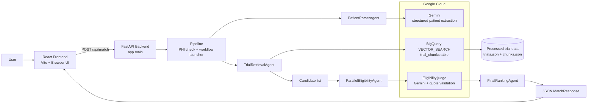
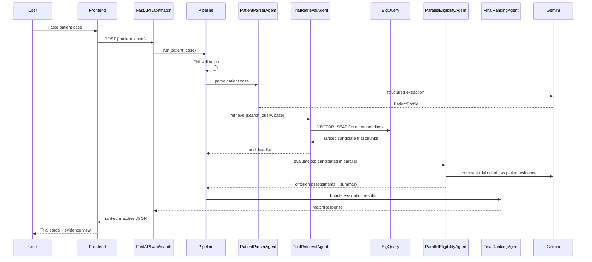

# Clinical Trial RAG

Clinical Trial RAG is a patient-to-trial matching application that helps a clinician or researcher review a de-identified patient case and find recruiting trials that are the closest match. The project combines:

- a FastAPI backend,
- a React frontend,
- Google Cloud BigQuery vector search,
- Vertex AI Gemini models for parsing and eligibility checking,
- and a workflow that ranks candidate trials using both similarity and evidence-based review.

The app is not a medical decision engine. It is a decision-support tool that extracts facts from a patient note, retrieves relevant trial chunks, checks eligibility against the trial text, and returns a structured, evidence-based summary.

---

## A. Project Overview

### What the project does
This repository builds a clinical-trial matching system for anonymized patient cases. A user pastes a clinical narrative such as a diagnosis, stage, biomarkers, prior treatments, and comorbidities. The system then:

1. extracts structured facts from the case,
2. finds relevant trials from the registry,
3. compares the patient to trial eligibility text,
4. verifies the model's evidence against the original text,
5. returns a ranked list of trials with verdicts such as ELIGIBLE, POSSIBLY_ELIGIBLE, or EXCLUDED.

### Why it matters
Clinical studies often have strict inclusion and exclusion criteria. A clinician may need to search across many open trials and compare patient facts to those criteria. Doing this manually is slow and error-prone. This project reduces that work by pulling candidate trials and showing the exact trial rule and patient evidence behind each judgment.

### Who can benefit
- Clinical research coordinators
- Trial matching teams
- Oncology or rare-disease study staff
- Data scientists and engineers building retrieval + LLM systems
- Developers learning RAG patterns for regulated domains

### Main features
- Patient case sanitization and PHI rejection
- Structured extraction of age, sex, conditions, findings, and search query
- Dense vector embedding for trial chunks in BigQuery
- Retrieval using GoogleSQL VECTOR_SEARCH
- Candidate ranking with reciprocal rank fusion (RRF)
- Deterministic verdict logic after model assessment
- UI that shows trial evidence, supporting criteria, blocking criteria, and missing information
- Local data ingestion pipeline for ClinicalTrials.gov records and optional PMC abstracts

### Expected outcome
A user can paste a case, review a small set of top trial matches, and understand why a trial is relevant or not, based on the actual wording of the trial criteria and patient note.

---

## B. What, Why, and How

### 1. Patient case intake and privacy filtering
What:
The FastAPI route accepts a patient_case string and rejects names, phone numbers, SSNs, and email addresses.

Why:
This prevents obvious personal-identifying information from being sent into model calls or stored in session state.

How:
The `PHI` regex in `backend/app/services/pipeline.py` checks for common identifiers before workflow execution.

Alternative:
A stricter HIPAA-style sanitizer could be used, but it would be more complex and less transparent. The current method is simple and visible in code.

### 2. Patient fact extraction
What:
The `parse_patient` service sends the de-identified case to Gemini and asks for a structured `PatientProfile` object.

Why:
The system needs a canonical representation of age, sex, condition, prior therapy, and key findings to build the search query and later assess trial fit.

How:
`backend/app/services/patient_parser.py` uses `genai.Client(...).models.generate_content()` with a JSON response schema.

Alternative:
A rules-based parser could extract limited facts, but this project chooses an LLM to capture more natural language details with a schema.

### 3. Retrieval of candidate trials
What:
The retrieval layer embeds the patient query and trial text chunks, then performs BigQuery vector search.

Why:
A full trial database is too large for naive string matching. Dense embeddings help find semantically similar chunks quickly.

How:
`retrieve()` calls `embed()` and then `execute_vector_search()` in `backend/app/services/retriever.py`.

Alternative:
Another approach would be keyword search alone, BM25, or a separate vector database. This project chooses BigQuery VECTOR_SEARCH because it keeps storage and search close together and avoids an external vector index service.

### 4. Eligibility evaluation
What:
For each top trial candidate, the system sends the trial eligibility criteria and patient case to Gemini, asking it to label specific inclusion and exclusion criteria as SUPPORTS, BLOCKS, or UNKNOWN.

Why:
The LLM does not decide final eligibility by itself. It provides criterion-level evidence that the application can verify and aggregate.

How:
`backend/app/services/eligibility_judge.py` builds a prompt and validates each returned quote against the original trial text and patient case.

Alternative:
A heuristics-only evaluator would be faster and cheaper, but it would miss nuance and is less transparent. The current project prefers evidence verification to reduce hallucination risk.

### 5. Final verdict and ranking
What:
The final verdict is deterministic: any BLOCKS criterion makes the trial EXCLUDED; otherwise unknowns lead to POSSIBLY_ELIGIBLE; otherwise ELIGIBLE.

Why:
This makes the result explainable and consistent instead of letting the LLM decide the final label.

How:
`compute_verdict()` in `eligibility_judge.py` implements the rules.

Alternative:
A more probabilistic scoring model could be used, but that would be less auditable and harder to explain to end users.

---

## C. Technology Stack

| Technology | What it is | Where it is used | Why it is used | Trade-offs |
|---|---|---|---|---|
| Python | Main backend language | All backend logic | Fast for API and ML integrations | Not as performant as compiled systems for some workloads |
| FastAPI | Python web framework | `backend/app/main.py` | Small API, valid request models, easy async integration | More limited than a full application framework in large enterprise systems |
| React + Vite | Frontend UI framework and dev tooling | `frontend/src/*` | Simple interactive UI with quick iteration | Lightweight but intentionally less opinionated than larger frameworks |
| BigQuery | Google Cloud data warehouse and SQL engine | Retrieval store and vector search | Stores embeddings and allows serverless `VECTOR_SEARCH()` | Requires GCP configuration and permissions |
| Google Gen AI / Gemini | LLM service | Parsing and criteria judging | Understands free-text medical narratives and structured output | Depends on external model availability and token costs |
| Vertex AI Embeddings | Dense embedding model | `backend/app/services/embeddings.py` | Creates semantic vectors for patient queries and trial chunks | Requires GCP and model access |
| Google ADK | Agent orchestration library | `backend/app/agents/workflow.py` | Coordinates parsing, retrieval, and parallel eligibility evaluation | Adds another abstraction beyond simple Python function calls |
| Pydantic | Data validation and schemas | `backend/app/schemas.py` | Enforces input/output shapes and response contracts | Validation errors can need careful handling |
| ClinicalTrials.gov API v2 | Registry data source | `backend/ingestion/fetch_trials.py` | Supplies open recruiting studies | API rate limits and field variability |
| PMC BioC API | Publication abstracts | `backend/ingestion/fetch_pmc.py` | Adds optional publication context for trials | External API availability and rate limits |
| Google Cloud Storage | Optional object storage | `backend/app/services/gcs_store.py` | Stores processed JSON blobs as a fallback or backup | Not required for the main runtime path |
| pytest | Automated tests | `backend/tests/*` | Checks retrieval, API, and ingestion logic | Not a full end-to-end cloud test suite |

---

## D. Complete Project Architecture

### High-level architecture



### Sequence diagram for a typical user request



### Implemented vs planned components
Implemented:
- patient parsing with Gemini
- retrieval against BigQuery embedding table
- eligibility judging with quote verification
- final ranking and UI
- ingestion scripts for ClinicalTrials.gov and optional PMC publication enrichment

Planned or optional:
- automated job scheduling for periodic ingestion
- production-grade caching and observability
- stricter RBAC / auth for multi-user deployment
- vector index tuning and sharding at large scale

---

## E. Complete Folder and File Structure

```text
CLINICAL-TRIAL-RAG/
├── README.md
├── .gitignore
├── backend/
│   ├── requirements.txt
│   ├── app/
│   │   ├── __init__.py
│   │   ├── config.py
│   │   ├── main.py
│   │   ├── schemas.py
│   │   ├── agents/
│   │   │   ├── callbacks.py
│   │   │   ├── state.py
│   │   │   └── workflow.py
│   │   └── services/
│   │       ├── eligibility_judge.py
│   │       ├── embeddings.py
│   │       ├── gcs_store.py
│   │       ├── patient_parser.py
│   │       ├── pipeline.py
│   │       ├── retriever.py
│   │       └── trial_store.py
│   ├── data/
│   │   └── processed/
│   │       ├── chunks.json
│   │       └── trials.json
│   ├── ingestion/
│   │   ├── build_index.py
│   │   ├── chunker.py
│   │   ├── fetch_pmc.py
│   │   ├── fetch_trials.py
│   │   └── ingest.py
│   ├── sql/
│   │   ├── init_bigquery.sql
│   │   └── verify_bigquery.sql
│   └── tests/
│       ├── test_ingest.py
│       ├── test_pipeline.py
│       └── test_retriever.py
├── frontend/
│   ├── index.html
│   ├── package.json
│   ├── vite.config.js
│   └── src/
│       ├── api.js
│       ├── App.jsx
│       ├── config.js
│       ├── main.jsx
│       ├── styles.css
│       └── components/
│           ├── ProfilePanel.jsx
│           └── TrialCard.jsx
└── .github/
    └── modernize/
        └── assessment/
            └── engines/
                └── facts/
                    └── architecture-diagram.md
```

### File-by-file explanation

#### Root files
- `README.md` — project overview and developer guide.
- `.gitignore` — excludes local environment artifacts and generated files.

#### `backend/app/config.py`
What:
Loads environment settings for GCP, BigQuery, embedding model, and workflow tuning.

Why:
The application needs a single place for runtime config so the same logic can run across local development and cloud environments.

How:
It uses `pydantic-settings` with `.env` support and environment alias names like `GCP_PROJECT`, `BIGQUERY_DATASET`, and `ADK_CONCURRENCY`.

Dependencies:
- `pydantic`, `pydantic-settings`

Connections:
Used by almost every backend service, including `embeddings.py`, `retriever.py`, `ingest.py`, and `workflow.py`.

Importance:
Without it, the app would not know project IDs, model names, or BigQuery table names.

#### `backend/app/main.py`
What:
Defines the FastAPI app and routes.

Why:
This is the public API layer for the frontend.

How:
It exposes `/api/health` and `/api/match`, converts exceptions to HTTP errors, and calls `pipeline.run()`.

Dependencies:
- FastAPI
- `app.schemas`
- `app.services.pipeline`
- `app.services.trial_store`

Connections:
Used by the React frontend through HTTP calls.

#### `backend/app/schemas.py`
What:
Contains request/response models for patient input and trial results.

Why:
This keeps the API contract clear and validates both incoming data and outgoing responses.

How:
Pydantic models define fields like `patient_case`, `PatientProfile`, `TrialMatch`, and `MatchResponse`.

Dependencies:
- `pydantic`

#### `backend/app/services/pipeline.py`
What:
The API-facing orchestration layer before the workflow begins.

Why:
It enforces privacy rules and calls the ADK workflow.

How:
It checks for PHI and raises a `ValueError` if identifiers are found.

#### `backend/app/services/trial_store.py`
What:
Loads the processed trial and chunk caches from `trials.json` and `chunks.json`.

Why:
The matching workflow needs a fast local lookup for metadata and evidence snippets.

How:
It uses `lru_cache` and optional GCS fallback. This is a local in-memory cache for request-time access.

#### `backend/app/services/embeddings.py`
What:
Generates dense embedding vectors with Gemini embeddings.

Why:
The retrieval layer needs vector representations for both patient queries and trial text chunks.

How:
It batches texts and normalizes vectors to unit length before returning them to the retrieval layer.

Dependencies:
- `google.genai`
- `numpy`

#### `backend/app/services/retriever.py`
What:
Finds candidate trial chunks using BigQuery `VECTOR_SEARCH`.

Why:
This replaces the older endpoint-based vector search pattern and keeps retrieval within Google Cloud's managed SQL environment.

How:
It builds a parameterized SQL query over the `embedding` column, executes it, and uses RRF to fuse results across multiple queries.

Dependencies:
- `google.cloud.bigquery`
- `app.config`
- `app.services.embeddings`
- `app.services.trial_store`

Connections:
Used by `backend/app/agents/workflow.py` through `retrieve()`.

#### `backend/app/services/patient_parser.py`
What:
Extracts a structured patient profile from the case narrative.

Why:
The app needs a clean, explicit representation of what the patient case states.

How:
Gemini returns a JSON object matching `PatientProfile`, and the code validates the age against the original case text.

#### `backend/app/services/eligibility_judge.py`
What:
An evidence-based eligibility judge that checks whether the patient matches a trial's inclusion/exclusion criteria.

Why:
This is the core "reasoning" step that makes the output explainable rather than just a black-box ranking.

How:
It builds a prompt with the trial text and patient case, checks Gemini output for quote validity, drops hallucinated entries, and computes a final verdict deterministically.

Dependencies:
- `google.genai`
- `app.config`
- `app.schemas`

#### `backend/app/agents/workflow.py`
What:
Defines the ADK workflow that coordinates the pipeline.

Why:
The project needs a multi-step process with retrieval, judgment, and final ranking in a controlled sequence.

How:
It creates a `SequentialAgent` with `PatientParserAgent`, `TrialRetrievalAgent`, `ParallelEligibilityAgent`, and `FinalRankingAgent`.

Dependencies:
- `google.adk`
- `app.services.patient_parser`
- `app.services.retriever`
- `app.services.eligibility_judge`
- `app.services.trial_store`

#### `backend/app/agents/callbacks.py`
What:
Privacy and observability guardrails for ADK agent execution.

Why:
The project wants a minimal privacy check before agent logic and some logging around execution timing.

How:
It raises an error if common PHI patterns are detected, and logs basic agent metadata.

#### `backend/app/agents/state.py`
What:
Stores standardized names for session state keys.

Why:
This keeps state management consistent across agents.

#### `backend/ingestion/fetch_trials.py`
What:
Downloads recruiting studies from ClinicalTrials.gov.

Why:
No local data is committed as a full registry; this script builds the dataset needed for matching.

How:
It queries the ClinicalTrials.gov API v2 and flattens fields such as eligibility and sponsor details.

#### `backend/ingestion/fetch_pmc.py`
What:
Uses PubMed or PMC identifiers to fetch abstracts from the PMC BioC API.

Why:
Optional publication enrichment improves trial context, though it is not required for the runtime retrieval path.

#### `backend/ingestion/chunker.py`
What:
Splits each trial into overview, inclusion, exclusion, and publication chunks.

Why:
Chunking helps vector search match the right evidence segments and keeps search vectors closer to specific criteria.

#### `backend/ingestion/ingest.py`
What:
Loads trial data, chunks, embeds them, validates them, and writes them to BigQuery.

Why:
This is the main ingestion pipeline for local or batch operations.

How:
It reads `trials.json`, chunks each trial, calls `embed()`, and writes `chunk_id`, `nct_id`, `chunk_text`, and `embedding` to the BigQuery table.

#### `backend/ingestion/build_index.py`
What:
Ensures the BigQuery dataset/table exists and can optionally create a vector index.

Why:
This creates the foundation for the retrieval engine.

#### `backend/sql/init_bigquery.sql`
What:
BigQuery SQL script to initialize schema.

Why:
Useful when running from the `bq` CLI instead of Python.

#### `backend/sql/verify_bigquery.sql`
What:
Checks row counts and confirms the vector-search table structure is valid.

#### `backend/tests/*`
What:
Tests for ingestion validation, retrieval logic, and endpoint compatibility.

Why:
These are the main guardrails for behavior and regressions.

#### `frontend/src/App.jsx`
What:
Main React application page and layout.

Why:
This is the user-facing experience for entering a patient case and viewing trial results.

How:
It shows a textarea, loading steps, and trial tabs.

#### `frontend/src/api.js`
What:
Wrapper around the backend API calls.

Why:
The frontend should not directly know the networking details for each request.

#### `frontend/src/components/TrialCard.jsx`
What:
Displays a single trial match with evidence and citations.

Why:
This makes the output understandable to a user who needs to see trial rules, patient evidence, and summary notes.

#### `frontend/src/components/ProfilePanel.jsx`
What:
Shows the structured patient profile extracted by the backend.

Why:
This lets the user validate the AI's interpretation of their case.

---

## F. End-to-End Data Flow

The actual flow in this repo is as follows:

1. Data ingestion begins in `backend/ingestion/fetch_trials.py`.
   - Input: ClinicalTrials.gov API responses.
   - Process: flatten study metadata and eligibility text.
   - Output: a list of trial records saved in `backend/data/processed/trials.json`.
   - Failure mode: the script raises an HTTP error if the API request fails or a study is malformed.

2. Optional publication lookup occurs in `backend/ingestion/fetch_pmc.py`.
   - Input: PubMed/PMC references in the trial records.
   - Process: map PMIDs to PMC IDs and fetch abstract text.
   - Output: `publications` data attached to relevant trial objects.
   - Failure mode: the script simply skips records when no PMC result is returned.

3. The trial record is chunked in `backend/ingestion/chunker.py`.
   - Input: one trial object.
   - Process: split it into overview, inclusion, exclusion, and publication chunks.
   - Output: chunk objects such as `NCT123::inclusion::0`.
   - Failure mode: a trial with missing eligibility text may produce a minimal record or no valid chunk.

4. `backend/ingestion/ingest.py` writes the chunk embeddings to BigQuery.
   - Input: `trials.json` and chunk texts.
   - Process: batch embedding generation, validation, duplicate filtering, and BigQuery insert.
   - Output: rows in the `clinical_trials.trial_chunks` table.
   - Failure mode: validation rejects bad embeddings, and BigQuery permission errors are logged.

5. A user sends a patient case to the frontend.
   - Input: free-text narrative in the browser.
   - Process: the React app calls `matchPatient()` in `frontend/src/api.js`.
   - Output: a JSON payload with `patient_case` to the backend.
   - Failure mode: the frontend surfaces any HTTP error detail returned by the backend.

6. The backend receives the request in `backend/app/main.py`.
   - Input: `MatchRequest` with `patient_case`.
   - Process: it calls `pipeline.run(req.patient_case)`.
   - Output: a `MatchResponse` object.
   - Failure mode: the app returns 400 for validation problems, 503 for permission issues, and 500 for unexpected failures.

7. `pipeline.run()` checks for PHI.
   - Input: raw patient note.
   - Process: regex scan for SSN, email, or phone patterns.
   - Output: workflow starts or `ValueError` is raised.
   - Failure mode: the API returns a 400 response.

8. The ADK workflow parses the patient case.
   - Input: original patient case.
   - Process: `parse_patient()` extracts `PatientProfile` with age, sex, conditions, therapies, findings, and `search_query`.
   - Output: structured profile stored in session state.
   - Failure mode: if the model fails or returns no valid JSON, the workflow can still continue with the fallback logic defined in the judge.

9. Retrieval runs against BigQuery.
   - Input: `search_query` and a short case slice.
   - Process: `retrieve()` embeds queries and executes `VECTOR_SEARCH()`.
   - Output: a list of `Candidate` objects with `nct_id`, `rrf`, `best_sim`, and evidence chunk IDs.
   - Failure mode: `RuntimeError` for bad BigQuery resources, `PermissionError` for IAM issues.

10. The judge evaluates each candidate.
   - Input: the patient case, the extracted profile, and a trial record.
   - Process: Gemini compares the trial's criteria to the patient evidence and returns criterion-level assessments.
   - Output: `CriterionResult[]`, summary, and `dropped_unverified` count.
   - Failure mode: the project logs warnings and drops invalid quote-based criteria that do not appear verbatim in source text.

11. Final ranking produces the response.
   - Input: all criterion results for the candidate set.
   - Process: `compute_verdict()` decides ELIGIBLE / POSSIBLY_ELIGIBLE / EXCLUDED; top results are selected and sorted.
   - Output: `MatchResponse` with `patient_profile`, `matches`, `disclaimer`, and `latency_seconds`.
   - Failure mode: a missing result causes the trial to be skipped from the final ranking.

12. The frontend renders the final output.
   - Input: `MatchResponse` JSON.
   - Process: React displays patient profile, verdicts, evidence, and passages.
   - Output: UI with tabs, criteria, and citations.
   - Failure mode: no results show an empty state panel until the user submits a valid case.

---

## G. Core Logic Explained

### 1. `pipeline.run()`
This function is the API-level entry point. It rejects possible personal identifiers before the workflow runs, then calls the Google ADK agent workflow. This is the first defensive layer against unsafe or personally identifying inputs.

Important behaviors:
- It checks to prevent SSN, email, and phone patterns.
- It raises a validation error before any GCP model call is made.

### 2. `retrieve()` and `VECTOR_SEARCH`
The retrieval pipeline builds a `list[str]` of queries and calls `embed()`. The returned vectors are validated; then each query vector is sent to a GoogleSQL `VECTOR_SEARCH` call against the `embedding` column in `trial_chunks`.

The user-visible result is a list of `Candidate` objects with:
- `nct_id`
- `rrf` (fused rank score)
- `best_sim` (best cosine similarity)
- `chunk_ids` (evidence list)

This is the main technical choice that sets the project apart from a simple keyword filter: the retrieval step is semantic and uses a vector search index in BigQuery.

### 3. `judge()` and quote verification
The judge has a strict prompt and a strong validation loop. It does not trust the model blindly. Every model-generated criterion quote is checked to ensure:

- it exists in the original eligibility text,
- the patient evidence exists in the patient case when the impact is SUPPORTS or BLOCKS,
- UNKNOWN values are treated without patient evidence,
- invalid or hallucinated statements are dropped and counted.

This is one of the project's biggest design decisions: evidence is verified before the result is shown to the user.

### 4. `compute_verdict()`
This is the deterministic decision logic:

- any BLOCKS result => EXCLUDED
- otherwise, if there are UNKNOWN results or no criteria => POSSIBLY_ELIGIBLE
- otherwise => ELIGIBLE

This ensures that the LLM is a criterion-level auditor, not the final decision-maker.

### 5. Google ADK workflow
The app uses `SequentialAgent` and `ParallelAgent` to orchestrate a workflow that:

1. parses the patient profile,
2. retrieves candidate trials,
3. evaluates trials concurrently,
4. ranks the final result set.

This is an explicit multi-step architecture that mirrors a classic agent pipeline rather than a single monolithic function.

### 6. Local trial cache and GCS fallback
The code keeps `trials.json` and `chunks.json` in `backend/data/processed/` and can optionally load them from GCS if `settings.gcs_bucket` is set. This makes local debugging easier and allows the service to operate even when the cloud backend is not configured.

---

## H. API Documentation

### Health endpoint
Method: `GET`
Endpoint: `/api/health`

Purpose:
Check whether the service is responding and whether the local trial index is loaded.

Example request:
```http
GET http://localhost:8000/api/health
```

Example response:
```json
{
  "status": "ok",
  "trials_indexed": 500
}
```

Possible status codes:
- `200 OK`

Source:
`backend/app/main.py`

### Match endpoint
Method: `POST`
Endpoint: `/api/match`

Purpose:
Accept a de-identified patient case and return ranked trial matches.

Request body:
```json
{
  "patient_case": "62-year-old woman with newly diagnosed stage IIIB non-small cell lung cancer, EGFR exon 19 deletion positive..."
}
```

Validation rules:
- `patient_case` is required.
- Minimum length is 40 characters.
- Maximum length is 8000 characters.
- A value containing SSN/email/phone patterns is rejected before workflow execution.

Example response:
```json
{
  "patient_profile": {
    "age_years": 62,
    "sex": "FEMALE",
    "primary_conditions": ["non-small cell lung cancer"],
    "comorbidities": [],
    "current_medications": [],
    "prior_treatments": [],
    "key_findings": ["EGFR exon 19 deletion positive", "stage IIIB"],
    "search_query": "EGFR exon 19 deletion positive stage IIIB non-small cell lung cancer"
  },
  "matches": [
    {
      "rank": 1,
      "nct_id": "NCT12345678",
      "title": "Trial title",
      "url": "https://clinicaltrials.gov/study/NCT12345678",
      "status": "RECRUITING",
      "phases": ["PHASE 2"],
      "conditions": ["non-small cell lung cancer"],
      "sponsor": "Example Sponsor",
      "locations": ["Boston, MA"],
      "relevance_score": 0.91,
      "verdict": "ELIGIBLE",
      "summary": "The assessed trial criteria are consistent with the provided case.",
      "criteria": [],
      "dropped_unverified": 0,
      "passages": []
    }
  ],
  "disclaimer": "Research decision-support only. Not medical advice.",
  "latency_seconds": 12.3
}
```

Possible status codes:
- `200 OK` — successful match
- `400 Bad Request` — invalid patient input or PHI detection
- `422 Unprocessable Entity` — request model validation error
- `503 Service Unavailable` — Google Cloud access denied
- `500 Internal Server Error` — unexpected failure

Source:
`backend/app/main.py` and `backend/app/schemas.py`

---

## I. Configuration and Environment Variables

The main settings live in `backend/app/config.py`. These values are read from `backend/.env` and can also be provided as environment variables.

| Variable | Default | Required? | Purpose |
|---|---:|---|---|
| `GCP_PROJECT` / `gcp_project` | empty string | Yes for cloud access | Google Cloud project ID |
| `GCP_LOCATION` / `gcp_location` | `us-central1` | Usually yes | Default region for Gemini and BigQuery operations |
| `BIGQUERY_DATASET` / `bigquery_dataset` | `clinical_trials` | Yes for search | Dataset containing trial chunks |
| `BIGQUERY_CHUNKS_TABLE` / `bigquery_chunks_table` | `trial_chunks` | Yes for search | Table with chunk text and embeddings |
| `BIGQUERY_LOCATION` / `bigquery_location` | `None` | Optional | Specific BigQuery location override |
| `EMBEDDING_MODEL` / `embedding_model` | `text-embedding-005` | Yes | Dense embedding model |
| `EMBEDDING_DIM` / `embedding_dim` | `768` | Yes | Vector length for embeddings |
| `GEMINI_MODEL` / `gemini_model` | `gemini-2.5-flash` | Yes | Model used for parsing and judging |
| `GCS_BUCKET` / `gcs_bucket` | empty string | Optional | Enables JSON uploads to GCS |
| `GCS_PREFIX` / `gcs_prefix` | `clinical-trials` | Optional | Prefix used in GCS object names |
| `TOP_K_CHUNKS` / `top_k_chunks` | `20` | Optional | Number of chunk hits per query |
| `CANDIDATES_TO_JUDGE` / `candidates_to_judge` | `6` | Optional | Max candidates sent to the judge |
| `FINAL_RESULTS` / `final_results` | `3` | Optional | Final number of ranked matches |
| `ADK_CONCURRENCY` / `adk_concurrency` | `6` | Optional | Parallel trial evaluation batch size |
| `ADK_TIMEOUT_SECONDS` / `adk_timeout_seconds` | `60.0` | Optional | Timeout for the workflow and sub-agents |
| `ADK_APP_NAME` / `adk_app_name` | `clinical_trial_matcher` | Optional | ADK session app name |

Example `.env` file:
```env
GCP_PROJECT=your-project-id
GCP_LOCATION=us-central1
BIGQUERY_DATASET=clinical_trials
BIGQUERY_CHUNKS_TABLE=trial_chunks
BIGQUERY_LOCATION=us-central1
EMBEDDING_MODEL=text-embedding-005
EMBEDDING_DIM=768
GEMINI_MODEL=gemini-2.5-flash
GCS_BUCKET=
GCS_PREFIX=clinical-trials
TOP_K_CHUNKS=20
CANDIDATES_TO_JUDGE=6
FINAL_RESULTS=3
ADK_CONCURRENCY=6
ADK_TIMEOUT_SECONDS=60
ADK_APP_NAME=clinical_trial_matcher
```

Important note:
This project does not contain any hidden production secrets in the repo. You should not commit real service-account credentials or API keys. Use your local environment or a secure secret-management system instead.

---

## J. Installation and Setup

### Prerequisites
- Python 3.11+
- Node.js 18+
- npm
- Google Cloud SDK and Application Default Credentials (ADC)
- BigQuery access to the target project
- Permission to use Gemini and embedding models in Vertex AI

### 1. Clone and open the repo
```powershell
cd C:\path\to\CLINICAL-TRIAL-RAG-
```

### 2. Create a Python virtual environment
```powershell
cd backend
py -m venv .venv
.\.venv\Scripts\Activate.ps1
python -m pip install --upgrade pip
pip install -r requirements.txt
```

### 3. Configure environment variables
Create a file named `.env` in the `backend` folder. Use the variables described above.

Example:
```powershell
Set-Content -Path .env -Value @"
GCP_PROJECT=your-project-id
GCP_LOCATION=us-central1
BIGQUERY_DATASET=clinical_trials
BIGQUERY_CHUNKS_TABLE=trial_chunks
BIGQUERY_LOCATION=us-central1
EMBEDDING_MODEL=text-embedding-005
EMBEDDING_DIM=768
GEMINI_MODEL=gemini-2.5-flash
"@
```

### 4. Authenticate to Google Cloud
```powershell
gcloud auth application-default login
gcloud config set project YOUR_PROJECT_ID
```

### 5. Initialize BigQuery resources
From `backend`:
```powershell
python -m ingestion.build_index
```
Or, if you prefer using the SQL script:
```powershell
bq query --use_legacy_sql=false < sql/init_bigquery.sql
```

### 6. Build or refresh the trial dataset
If you do not already have processed trial files:
```powershell
python -m ingestion.fetch_trials
```
Then, if you want optional PMC enrichment:
```powershell
python -m ingestion.fetch_pmc
```
Then ingest the data into BigQuery:
```powershell
python -m ingestion.ingest
```
Optional force refresh:
```powershell
python -m ingestion.ingest --refresh
```

### 7. Verify the BigQuery table
```powershell
bq query --use_legacy_sql=false < sql/verify_bigquery.sql
```

### 8. Install frontend dependencies
```powershell
cd ..\frontend
npm install
```

### 9. Start the application
Backend:
```powershell
cd ..\backend
.\.venv\Scripts\Activate.ps1
uvicorn app.main:app --host 127.0.0.1 --port 8000 --reload
```
Frontend:
```powershell
cd ..\frontend
npm run dev
```
Then open:
- Frontend: http://localhost:5173
- API: http://localhost:8000

### 10. Run tests
From `backend`:
```powershell
pytest -q
```

Required vs optional steps:
Required:
- install backend dependencies
- configure GCP and BigQuery settings
- create the BigQuery table
- start the backend and frontend

Optional:
- GCS upload
- PMC enrichment
- creating a vector index in BigQuery

---

## K. Alternatives and Design Trade-Offs

| Design choice | Current approach | Why it fits this project | Benefits | Limitations | Alternative |
|---|---|---|---|---|---|
| Retrieval engine | BigQuery `VECTOR_SEARCH()` | Keeps embeddings and metadata in one managed system | Simple operational model, no custom vector service | Requires GCP + BigQuery permissions | Vertex AI Vector Search or a separate vector DB |
| LLM orchestration | Google ADK sequential/parallel agents | Good separation of parsing, retrieval, and judging | Clear execution flow and easier debugging | More moving pieces than a single function | A strict Python pipeline without agent abstractions |
| Eligibility logic | Gemini + quote validation + deterministic verdict | Makes results more explainable and auditable | Users can see evidence-backed decisions | Still depends on LLM output quality | Pure rules-based matching or keyword heuristics |
| Data storage | `trials.json` + `chunks.json` + BigQuery table | Local debugging plus cloud search | Simple dev cycle and production search | Duplicate storage of some data | Single source-of-truth database only |
| Frontend architecture | React with direct fetch to `/api/match` | Minimal UI complexity and minimal dependencies | Fast to build and easy to inspect | Less structured than a larger app framework | Next.js or another full-stack framework |

---

## L. Error Handling and Troubleshooting

### Common setup problems
- `ModuleNotFoundError` / missing packages
  - Fix: activate the virtual environment and run `pip install -r requirements.txt`.

- BigQuery access denied
  - Fix: verify the user or service account has `BigQuery Data Viewer` and `BigQuery Job User` roles.

- Project or dataset not found
  - Fix: confirm `GCP_PROJECT`, `BIGQUERY_DATASET`, and location values are set correctly.

- Embedding dimension mismatch
  - Fix: verify `EMBEDDING_DIM=768` and the same value is used in schema creation and query execution.

### API and model failures
- Gemini request fails
  - The judge returns a safe summary and no fabricated eligibility label.

- No structured output from Gemini
  - The project falls back to the deterministic age/sex checks and warns in logs.

- BigQuery vector search query fails
  - `RuntimeError` or `PermissionError` is surfaced to the endpoint with a clear message.

### Network and runtime issues
- Local frontend cannot reach backend
  - Verify the backend is running on port `8000` and the frontend is using the correct API base.

- Local data files missing
  - Re-run the ingestion scripts before testing the match flow.

### Useful debugging steps
- Inspect the backend logs for `Permission denied`, `NotFound`, or `BadRequest` messages.
- Confirm the `.env` file is in `backend/` instead of the repo root.
- Check the `backend/data/processed/` folder for `trials.json` and `chunks.json`.
- Run the test suite to isolate broken logic before modifying the workflow.

---

## M. Security, Privacy, and Reliability

### Existing protections
- PHI regex rejects obvious identifiers before workflow execution.
- Patient narratives are kept in session state only during a request; the app does not persist them to a database.
- Structured output schemas limit model output to expected fields.
- Quote verification prevents some hallucinated trial statements from passing through to the UI.
- The API converts low-level exceptions into safe HTTP responses.

### Remaining risks
- Model output is still probabilistic and may be wrong in subtle or edge cases.
- The project uses external cloud services and therefore depends on their availability and access rights.
- The current approach is designed for research support, not direct patient-care automation.
- The local ingestion dataset can go stale if the ClinicalTrials.gov registry changes and the data is not refreshed.

### Recommended improvements
- Add explicit auth for multi-user deployments.
- Add request logging with redaction for patient narrative text.
- Add retry/backoff around external API calls.
- Add audit logs of model prompts and summarized outputs for review.

---

## N. Testing and Code Quality

The repository contains tests in `backend/tests/`.

### Test coverage
- `test_pipeline.py` checks PHI filtering, pipeline integration, and API behavior.
- `test_retriever.py` checks embedding validation, SQL generation, RRF scoring, and BigQuery errors.
- `test_ingest.py` checks validation and duplicate filtering logic.

### Run tests
From the `backend` folder:
```powershell
pytest -q
```

### Observed gaps
- No end-to-end live cloud test against a real BigQuery table or real Gemini model is committed in the repo.
- There are no frontend browser tests.
- There is no dedicated linting or formatting configuration in the repo snapshot.

These are not failures in the project; they are simply current limitations of the test suite.

---

## O. Limitations and Future Improvements

### Verified limitations
- The runtime depends on Google Cloud access and credentials.
- The system is built around the provided trial dataset; it is not a full zero-latency registry system.
- The final verdict is deterministic but still dependent on the quality of model-generated criterion assessments.
- The project is designed as a research-support tool, not a regulated production clinical decision platform.

### Practical future improvements
- Add scheduled re-ingestion from ClinicalTrials.gov.
- Add a user auth layer and role-based access control.
- Add response caching for repeated patient queries.
- Add stronger telemetry and observability for model latency and failure rates.
- Add automated end-to-end tests using a mock or sandbox GCP environment.

---

## P. Quick Reference

### Important commands
```powershell
# backend setup
cd backend
py -m venv .venv
.\.venv\Scripts\Activate.ps1
pip install -r requirements.txt

# initialize BigQuery resources
python -m ingestion.build_index

# fetch and ingest data
python -m ingestion.fetch_trials
python -m ingestion.fetch_pmc
python -m ingestion.ingest

# run backend
uvicorn app.main:app --host 127.0.0.1 --port 8000 --reload

# run frontend
cd ..\frontend
npm install
npm run dev

# run tests
cd ..\backend
pytest -q
```

### Main entry points
- Backend API: `backend/app/main.py`
- Pipeline orchestration: `backend/app/services/pipeline.py`
- Retrieval logic: `backend/app/services/retriever.py`
- Eligibility judge: `backend/app/services/eligibility_judge.py`
- ADK workflow: `backend/app/agents/workflow.py`
- Frontend entry: `frontend/src/App.jsx`

### Important directories
- `backend/app` — API, schemas, services, and workflow code
- `backend/ingestion` — registry download and embedding ingestion scripts
- `backend/data/processed` — generated trial and chunk cache files
- `backend/tests` — regression tests
- `frontend/src` — React components and API layer

### API base URL
- Backend: http://localhost:8000
- Frontend: http://localhost:5173

### Key configuration variables
- `GCP_PROJECT`
- `GCP_LOCATION`
- `BIGQUERY_DATASET`
- `BIGQUERY_CHUNKS_TABLE`
- `EMBEDDING_MODEL`
- `EMBEDDING_DIM`
- `GEMINI_MODEL`
- `CANDIDATES_TO_JUDGE`
- `FINAL_RESULTS`

### Where to begin when modifying a feature
- Want to change the API contract? Start in `backend/app/schemas.py` and `backend/app/main.py`.
- Want to change retrieval or ranking? Start in `backend/app/services/retriever.py` and `backend/app/agents/workflow.py`.
- Want to change evidence scoring or judge behavior? Start in `backend/app/services/eligibility_judge.py`.
- Want to change the user experience or display? Start in `frontend/src/App.jsx` and `frontend/src/components/*`.
- Want to refresh the underlying trial dataset? Start in `backend/ingestion/`.

---

## Final note
This repository is a research-oriented clinical trial matching system with a clear separation between data ingestion, semantic retrieval, evidence-based eligibility judge logic, and presentation. The code reflects a practical architecture: secure input handling, BigQuery-based vector search, Gemini for structured extraction and assessment, and a frontend designed to show audit-friendly evidence rather than just a single ranked result.

