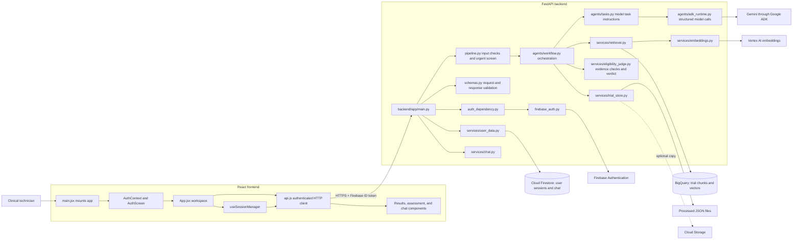
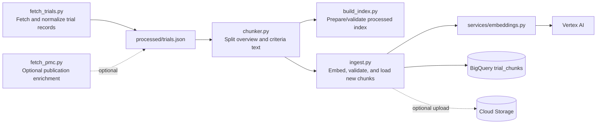

# Clinical Trial RAG: File Flow and Responsibilities

This guide follows a request from the user's browser through the backend and cloud services, then maps the main files to their jobs. It describes the current repository implementation.

## 1. System at a glance



## 2. What happens when a user searches

```mermaid
sequenceDiagram
    actor Technician
    participant UI as App.jsx
    participant Hook as useSessionManager.js
    participant Client as api.js
    participant Route as main.py
    participant Auth as auth_dependency.py / firebase_auth.py
    participant Store as user_data.py / Firestore
    participant Pipe as pipeline.py
    participant Flow as agents/workflow.py
    participant Search as retriever.py / embeddings.py / BigQuery
    participant AI as tasks.py / adk_runtime.py / Gemini
    participant Judge as eligibility_judge.py

    Technician->>UI: Enter a de-identified case and submit
    UI->>Hook: Select or create a session
    UI->>Client: matchPatient(case, sessionId)
    Client->>Client: Add Firebase ID token
    Client->>Route: POST /api/match
    Route->>Auth: Verify token and obtain UID
    Route->>Store: Check session ownership; save query
    Route->>Pipe: Validate case and screen urgent phrases
    Pipe->>Flow: Start matching if screening allows it
    Flow->>AI: Extract supported patient facts
    AI-->>Flow: Structured profile
    Flow->>Search: Retrieve candidate trial chunks
    Search-->>Flow: Ranked trial candidates
    opt No candidate or weak retrieval
        Flow->>AI: Propose one profile-grounded refinement
        Flow->>Search: Run at most one additional retrieval
        Search-->>Flow: Merge and deduplicate candidates
    end
    loop For shortlisted candidates (bounded)
        Flow->>AI: Assess trial criteria using supplied record text
        AI-->>Flow: Proposed criteria, quotes, and explanations
        Flow->>Judge: Verify evidence and compute conservative verdict
    end
    Flow-->>Route: Structured result and evidence
    Route->>Store: Save result under the user's session
    Route-->>Client: Match response with session ID
    Client-->>UI: Display results and clinical assessment
```

## 3. Frontend files

| File or folder | Purpose / contents | Change it when… |
|---|---|---|
| `frontend/src/main.jsx` | Mounts React, `AuthProvider`, and global styles. | Changing application startup or root providers. |
| `frontend/src/firebase.js` | Firebase browser SDK configuration and exports. | Changing client Firebase setup. |
| `frontend/src/auth/AuthContext.jsx` | Tracks sign-in state, profile, loading, and logout lifecycle. | Changing authenticated user state. |
| `frontend/src/auth/AuthScreen.jsx` | Sign-in and account-creation forms. | Changing login/signup UI or validation. |
| `frontend/src/App.jsx` | Main workspace state, search submission, result selection, and navigation between views. | Connecting a new main workflow or screen. |
| `frontend/src/api.js` | HTTP functions; attaches Firebase ID token and handles API responses/errors. | Adding/changing backend requests. |
| `frontend/src/hooks/useSessionManager.js` | Loads, creates, switches, renames, and deletes saved sessions. | Changing session behavior in the browser. |
| `frontend/src/components/layout/` | Shared app shell, header, footer, and welcome area. | Changing global page layout. |
| `frontend/src/components/session/` | Session sidebar, session rows, and rename modal. | Changing saved-session controls. |
| `frontend/src/components/results/` | Results overview, trial tabs/details, criteria, evidence passages, and assessment page. | Changing match or criterion presentation. |
| `frontend/src/components/chat/ChatDrawer.jsx` | Follow-up trial question and answer interface. | Changing chat UI. |
| `frontend/src/components/ui/` | Reusable buttons, cards, badges, dialogs, icons, artwork, skeletons, and toast. | Reusing or adjusting common controls. |
| `frontend/src/utils/` | Formatting, deduplication, assessment labels, local storage, and report generation. | Changing shared display/data helpers. |
| `frontend/src/styles.css`, `frontend/src/styles/clinical-design.css` | Global and clinical theme styles. | Changing site-wide styling. |

## 4. Backend files

| File or folder | Purpose / contents | Change it when… |
|---|---|---|
| `backend/app/main.py` | FastAPI routes, middleware, request IDs, auth dependencies, and HTTP error mapping. | Adding or changing an endpoint. |
| `backend/app/schemas.py` | Pydantic request/response shapes shared across route and workflow boundaries. | Changing JSON data exchanged by frontend/backend. |
| `backend/app/config.py` | Reads environment configuration and service settings. | Adding a backend setting or changing defaults. |
| `backend/app/safe_logging.py` | Sanitized error logging and request-ID context. | Changing safe operational logging. |
| `backend/app/services/auth_dependency.py` | Requires a valid authenticated Firebase user on protected routes. | Changing route authentication requirements. |
| `backend/app/services/firebase_auth.py` | Firebase Admin initialization, token verification, and Firestore client access. | Changing backend Firebase setup. |
| `backend/app/services/user_data.py` | UID-scoped profiles, sessions, saved search/results, and chat persistence. | Changing Firestore data behavior. |
| `backend/app/services/pipeline.py` | Validates case length/identifiers, runs urgent screen, and calls the workflow. | Changing pre-match safety/input handling. |
| `backend/app/agents/workflow.py` | Coordinates fact extraction, retrieval/refinement, criteria assessment, ranking, and result assembly. | Changing the end-to-end matching process. |
| `backend/app/agents/tasks.py` | Instructions and structured outputs for extraction, refinement, criteria assessment, and chat. | Changing what each model task is asked to do. |
| `backend/app/agents/adk_runtime.py` | Runs bounded Google ADK model calls and manages their temporary sessions. | Changing model invocation/runtime behavior. |
| `backend/app/agents/tools.py` | Gives agents bounded access to approved trial retrieval. | Changing model-accessible tools. |
| `backend/app/services/retriever.py` | Queries BigQuery vector search and ranks/deduplicates candidate trials. | Changing trial retrieval. |
| `backend/app/services/embeddings.py` | Calls Vertex AI to embed search text. | Changing query/document embedding behavior. |
| `backend/app/services/eligibility_judge.py` | Verifies trial/patient quotes and computes deterministic preliminary verdicts. | Changing evidence verification or verdict rules. |
| `backend/app/services/trial_store.py` | Loads processed trial records/chunks from configured storage with local fallback. | Changing trial metadata access. |
| `backend/app/services/chat.py` | Retrieves evidence for allowed trial IDs and builds grounded chat answers. | Changing follow-up question behavior. |
| `backend/app/services/safety.py`, `untrusted_text.py` | Supported-fact validation, urgent screening helpers, prompt-injection text handling. | Changing safety checks or handling of untrusted text. |

## 5. Trial data ingestion files

This is an offline preparation path. It does not run for each user search.



| File | Purpose |
|---|---|
| `backend/ingestion/fetch_trials.py` | Downloads ClinicalTrials.gov records and normalizes trial metadata. |
| `backend/ingestion/fetch_pmc.py` | Optional collection/enrichment from PubMed Central. |
| `backend/ingestion/chunker.py` | Splits trial records into retrieval-friendly text chunks. |
| `backend/ingestion/build_index.py` | Builds or validates local processed data/index inputs. |
| `backend/ingestion/ingest.py` | Creates embeddings, validates records, and loads chunks to BigQuery; optionally writes processed JSON to GCS. |
| `backend/sql/init_bigquery.sql`, `verify_bigquery.sql` | BigQuery setup and verification queries. |
| `backend/data/processed/trials.json`, `chunks.json` | Processed local trial records and chunk cache/fallback data. |

## 6. Other operational files

| File | Purpose |
|---|---|
| `backend/Dockerfile`, `frontend/Dockerfile` | Container build instructions for backend and frontend. |
| `frontend/nginx.conf`, `frontend/vite.config.js` | Frontend static serving and local development/build configuration. |
| `backend/.env.example`, `frontend/.env.example` | Names and examples of required configuration; must not contain real secrets. |
| `firebase.json`, `firestore.rules` | Firebase hosting/configuration and browser Firestore access rules. |
| `deploy/deploy-cloud-run.ps1`, `deploy/README.md` | Cloud Run deployment script and deployment steps. |
| `backend/tests/` | Tests for workflow, API services, retrieval, ingestion, chat, and safety. |
| `ARCHITECTURE.md` | Broader system, data, security, deployment, and production-flow diagrams. |

## 7. Where to start for common changes

| Goal | Start with |
|---|---|
| Add a screen or change interaction flow | `frontend/src/App.jsx` and the relevant `frontend/src/components/` file |
| Add an API endpoint | `backend/app/main.py`, then `backend/app/schemas.py` and `frontend/src/api.js` |
| Change saved session behavior | `backend/app/services/user_data.py`, `backend/app/main.py`, and `frontend/src/hooks/useSessionManager.js` |
| Change how patient facts are extracted | `backend/app/agents/tasks.py`, then `backend/app/agents/workflow.py` |
| Change trial search quality | `backend/app/services/retriever.py`, `backend/app/services/embeddings.py`, and ingestion data |
| Change criteria assessment | `backend/app/agents/tasks.py`, `backend/app/services/eligibility_judge.py`, and `backend/app/schemas.py` |
| Change trial data source or fields | `backend/ingestion/fetch_trials.py`, `chunker.py`, `ingest.py`, and `trial_store.py` |
| Change service configuration/deployment | `backend/app/config.py`, `.env.example`, Dockerfiles, and `deploy/` files |

The workflow provides preliminary research support. Trial evidence and criteria should remain visible so a qualified clinical team can independently review the official record.
